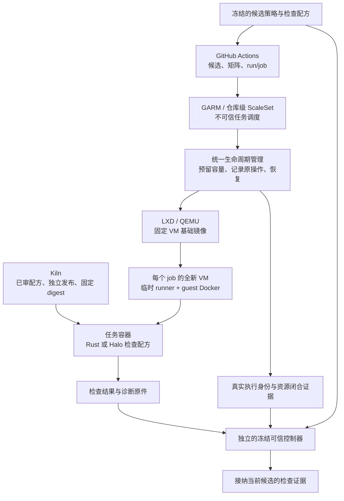

# Nucleus 与 agents CI 全面设计草案

本方案覆盖普通 PR、原生 stack、Nucleus 晋级、可信审查与准入、控制器恢复，以及 Kiln 和 Halo VM runner 的接入。目标是用清晰的职责和统一证据契约重建流程。完整设计仍有待收敛项；已选首片沿 Actions、Cubic 和 Cladiron，完成 agents 一个普通 PR 的可信准入、合规 squash、原操作恢复及必要清理。现有源码、保护和部署尚未按本方案切换。

## 已确定的目标与边界

App 负责批准和可信准入检查。执行 merge 的主体与批准主体分开，不能把“仅 App 可以合并”当作 Human 的要求。现有 Nucleus 交付契约明确由仓库写权限决定合并身份，平台保护决定合并条件。迁移适配曾采用的 App 独占更新机制是可替换的技术方案。

普通 PR 和原生 stack 都属于目标。每片仍须形成完整业务结果；stack 不能成为把必要事务、消费者或恢复能力拆到未来片的理由。设计不预设两层上限，实际层数及分页边界须有验收。

Nucleus 的实现进入 dev；固定候选经整体验收后晋级 main，不将 main 回灌 dev。agents 和 Kiln 遵循各自的目标分支契约。实际部署默认关闭。

沿用准确既有仓库和 App，保持私有，不购买产品或新建替代对象。迁移运行闭环优先，Kiln 治理最后。独立 runner 准备不阻断可完成的迁移工作。

当前实施范围限于已选 agents 普通 PR 首片，包含必要实现、文档、检查、正式审查、修复、权限、恢复、受控切换和真实验收。Codex 自动兜底、Nucleus 晋级、native stack、Halo/Kiln 保留为后续独立片。runner 初始容量仍为一个任务，不能据此扩大为多 VM 并行池。

## 迁移后的运行闭环

迁移接纳以原仓库身份和真实消费者为准，仓库名称改变不构成运行闭环。保持准确 repository ID、私有性、有效 refs、默认分支和保护对象的连续关系。同一 Cladiron 在个人账户的安装只接纳明确仓库；新安装权限不自动授权候选或 runner 使用 App 私钥。

| 消费者 | 需要闭合的绑定 |
| --- | --- |
| 托管 CI 与准入控制器 | 准确仓库、可信源码/成品、安装、Environment、事件与最小权限 token |
| 审查供应商 | 迁后仓库访问、个人账户实际权益、真实运行输入与结果 |
| GARM 与 runner | 准确仓库登记、ScaleSet、安装、guard/provider 和独立管理凭据 |
| Kiln 构建与发布 | 已审配方、完整构建产物、包归属及发布权限 |
| Nucleus 镜像消费者 | 准确仓库的短期 job token、包访问授权与初始化拉取 |

按消费者分别验证，不以一次 token 创建成功代表全部权限有效。控制器写权限留在可信控制面；候选 job 只获得其检查必要的仓库及包读取权限。审批、检查发布、合并、runner 管理和镜像发布按真实能力缩小授权；拆成几个进程本身不缩小同一 App 私钥的安装授权上限。

切换期间保留当前 fences 和 Environment。迁后事件按仓库身份、安装及真实输入验证，重复投递复用原处理结果；旧来源或旧候选的迟到事件不能恢复已经失效的准入。启用新控制器前停止旧发送者，核清在途写及凭据生命周期，再绑定新版本。读权限、受控 CI 和合并路径分别接纳，不把开启 Actions 当作解除保护。

清理只针对已确认的旧消费者和凭据持有点。替代消费者在新绑定下真实成功后，依原授权撤销对应旧凭据并读回；未知撤销先恢复原操作，不重复发送。旧历史 Secret 的可见数量差异按既有豁免处理，不据此猜测第三消费者。回退使用已保全的具体前态，不自动把仓库迁回原组织或重新启用旧权限。

本设计不重做已经覆盖准确对象的迁移检查。仍未完成的运行、准入、VM、镜像和旧依赖清理各自保留验收责任，不能以设计批准代替真实消费者闭环。

## PR 使用方式

| 场景 | 推荐形式 | 审查与落地要求 |
| --- | --- | --- |
| 独立功能、修复、文档 | 普通 PR，默认选择 | 一个完整业务结果，准确候选通过审查和集成检查 |
| 后续业务结果依赖未合并的前层 | 原生线性 stack | 每层增量审查，每个可合并前缀验证，选择合格前缀整体落地 |
| dev 到 main 的发布 | 固定候选晋级 PR | 固定发布范围和目标基线，完成整体业务验收 |
| 控制器自身变更 | 普通或有真实依赖的 stack PR | 源码合并与可信成品激活分别处理，候选不得自行激活 |

Draft/Ready 表达准备状态，不是另一种依赖结构。Draft 阶段提供必要开发反馈；进入正式审查与合并准备时，补齐规定的覆盖。状态变化不能免除已知发现的处置。

已选合并方式为：普通实现 PR 和原生 stack 使用 squash，每片落地为一个完整业务提交；Nucleus dev 到 main 晋级使用保留既定父关系的 merge commit。原生 stack 合并 n 个 PR 时产生 n 个 squash 提交，并作为同一原子操作落地，不将整个前缀压成一个提交。[Stack 合并方式](https://docs.github.com/en/pull-requests/reference/stacked-pull-requests#merge-methods)

方法绑定到对应业务路径和集成计划。为了晋级而允许 merge commit，不代表普通实现也可绕过已选 squash 规则；不能只在控制器请求中写 squash，却忽略其他实际入口。所选片须核目标分支、平台配置和各入口如何执行该规则，再验证准确结果。不能用全仓库只开 squash 破坏晋级父关系，也不能只因分支数量增加就使用 stack。

## 职责与信任边界

| 能力 | 拥有的事实与决定 |
| --- | --- |
| 仓库交付契约 | 业务验收、适用检查、目标分支与发布条件 |
| 候选编排 | PR 身份、依赖、准确审查输入和集成计划；计算变化影响 |
| CI 执行 | 用固定配方和环境运行检查，产生真实执行与产物证据 |
| 审查适配 | 供应商来源、输入、覆盖、完成状态、发现及原处置 |
| Cladiron 准入 | 核对当前计划所需证据，发布批准及指定 App 检查 |
| 合并操作 | 消费有效准入，保存准确请求、原操作及真实结果 |
| runner 生命周期 | 容量、VM/runner/job 关联、阶段期限和完整回收 |
| Kiln 发布 | 构建来源、产物、registry digest 和消费兼容性 |
| 控制器部署 | 可信版本激活、在途兼容、升级与恢复 |

共享实现放在 agents，Nucleus 的业务要求仍由 Nucleus 文档与配置拥有。候选执行不得取得 App 私钥、管理会话、控制服务 socket 或可写发布目录。可信控制面读取有界数据，不执行候选 artifact 中的代码。

App 的批准与最终检查不等于 App 独占执行 merge。自动化可以有一个合并 owner；任何实际合并主体均须满足平台保护。App 私钥仍代表整个安装授权上限，不因拆分进程或模块就变成独立安全主体。

## 统一输入与证据

| 对象 | 契约 |
| --- | --- |
| 审查输入 | 准确审查基线 Br、候选 H、直接父层、实际差异与上下文、权威要求版本 |
| 集成计划 | 准确目标基线 Bi、目标分支、有序合并前缀、每层身份与版本、合并方式、各前缀集成候选 I |
| 证据 | 真实输入、生产者、run/attempt、环境、结果、原报告、发现处置及覆盖限制 |
| 原操作 | 固定计划和请求、发送阶段、平台 UUID、原响应、成员结果及终态 |

普通 PR 是一个成员的计划。对于 stack，第 k 个前缀包含第一层至第 k 层，不包含未来层。下层审查键不加入上层 SHA 或 stack 总层数。

CI 必须核真实检出的 commit/tree、检查程序、依赖和环境。tree 相同不自动证明历史、父序、规则或外部状态等输入相同。预测集成对象应标为预测；合后对账不能补成平台未提供的合前保证。

原证据保持最初来源。复用时记录新消费者与输入等价依据，不把旧运行改写成新运行。缓存只加速执行，不能充当验收结论。

准入与合并分别核四类事实，不把它们混成一个 SHA 绿灯：

| 条件 | 责任与复用方式 |
| --- | --- |
| 内容和集成证据有效 | 实际审查输入、业务要求、目标基线及集成范围等价时可复用；阻断发现必须已处置 |
| 当前 PR 有资格 | 目标与范围获授权，成员 open/ready，依赖、适用批准计数、讨论、签名和保护条件满足 |
| 本 PR 的 Cladiron 批准有效 | 核当前 PR 的原 review 对象、App 身份、准确候选与适用输入；批准未 dismissed、撤销或被新事实推翻，不能借用另一 PR 的批准 |
| 原操作允许发送 | 成员选择与合并方式获授权，没有尚未查明的原发送；观察取消或超时不能清除未知状态 |

PR 编号与运行标识用于路由、批准及原操作恢复，不必成为内容证据的人工失效键。关闭期间 PR 不具备合并资格；重新打开后，原批准若仍有效、准确绑定候选且没有被撤回或新事实推翻，可以继续使用。另一 PR 可以复用等价审查与 CI，却仍需它自己的有效批准和讨论状态。该语义是新设计提议，尚未替换现有控制器策略。

### 检查配方与执行

仓库交付契约选择检查范围，可信控制器固定配方版本、执行输入和预期结果。候选中的 workflow、脚本及工具链变更都是被检查对象；它们不能自行删除必需检查，或把自身成功解释为门禁通过。配方确需执行候选脚本时，将其放在不可信执行环境，另由可信收集器核对任务、退出状态、报告完整性和准确输入。

普通 PR 同时保留内容审查输入与目标基线上的集成输入。stack 每层审查直接父层到本层的差异；每个准备合并的前缀都要有对应集成验证。单层绿色不能代表前缀业务验收，顶层绿色也不能代表所有较短前缀。晋级沿用固定候选的整体检查，不能把各实施 PR 的结果简单相加。

事件处理与检查发送之间先保存需求及原执行身份。重复通知查已有运行；只有确认原运行终态且确有未覆盖需求时才安排新执行。失败检查保留真实失败；修复后运行绑定新输入，不把旧 attempt 的迟到成功覆盖新失败。artifact 下载、解包和报告解析均有资源上限，且不授予候选产物控制面执行权限。

## 事件与失效

事件负责定位变化，受信读取确定当前事实。重复、乱序事件与旧结果晚到不能重复触发审查、检查或合并。

若使用 webhook，可信接收器先限制请求大小，并按原始请求字节验证签名，再解析数据及核对允许的安装、仓库和事件类型。签名证明来源与完整性，不证明候选已获授权。保存 delivery 身份、内容摘要和待处理需求后才确认接收；重复投递复用原记录，相同身份却内容矛盾时停止受影响处理。恢复沿原需求读取当前权威状态，不能直接把旧 payload 当成当前准入结论。缺签名、错误安装或仓库的请求不能安排带写权限的动作。[签名验证](https://docs.github.com/en/webhooks/using-webhooks/validating-webhook-deliveries)、[投递处理](https://docs.github.com/en/webhooks/using-webhooks/best-practices-for-using-webhooks)

| 变化 | 处理范围 |
| --- | --- |
| 第 j 层内容或直接父层变化 | 重算第 j 层及依赖后缀，保留未受影响下层 |
| 只增加或修改上层 | 核新拓扑，已有下层审查和前缀检查继续有效 |
| trunk 前进 | 旧 Bi 集成计划失效；按交互影响补审和验证 |
| 纯 rebase 或 SHA 变化 | 建立新绑定，仅复用已证明等价的输入覆盖 |
| 关闭重开、同 SHA 新 PR | 复核当前资格与原操作；输入等价时复用证据，不因生命周期计数机械重审、重跑或替换批准 |
| 新发现或原发现重新打开 | 相关准入失效，保留不受影响的 CI，不重跑掩盖发现 |
| 下层已落地 | 保存准确结果，为剩余成员重新绑定父关系和计划 |
| 检查或规则版本变化 | 按受影响输入补覆盖，不机械清空全部历史 |

## 审查与准入

代码审查和安全审查须覆盖实际候选与基线。Cubic 为个人仓库的主要供应商；仅在真实额度耗尽且 Codex 预算保护能力已核实后，启用等价的自动兜底。连接故障、超时、缺评论或 HTTP 限流不证明额度耗尽。

适配层以实际输入或已核供应商契约，结合外部原记录，证明供应商身份、准确输入、所需审查种类、完成状态及发现。托管 App 可以通过自己的完成摘要表达无发现结果，不强求另一供应商的工件形式。公开“完成”仍不能单独证明准确基线；换供应商时保留原发现和处置。

Cubic 官方说明常规 PR 审查包含潜在安全问题检查；代码与安全覆盖可以来自同一次真实审查，不要求为了名称另跑一个 scan。其后续审查可能只覆盖增量，适配层必须保留完整覆盖链及未解决发现，不能把最后一次增量报告当作全量证明。[审查范围](https://docs.cubic.dev/ai-review/key-features)

公开接口已规定审查范围：MCP 的 `trigger_pr_review` 发起全量 PR 审查，已有排队或运行中的审查则沿用原执行；增量审查覆盖上次完成审查之后的变化，无法确定安全范围时停止，不自动改成全量。这些契约与原触发、head、完成及发现记录共同参与覆盖判断，不需要先向供应商询证才能采用。[MCP 审查工具](https://docs.cubic.dev/ide/mcp-server#available-tools)、[全量与增量触发](https://docs.cubic.dev/ai-review/interactive-comments#trigger-reviews)

供应商配置也是审查输入。Cubic 的 `cubic.yaml` 取默认分支，字段按配置层级合成；无效 YAML 可回落到 UI 设置而继续审查。配置 owner 在启用及变更时核对可信配置、来源、规则范围与错误回落。单次审查复用仍有效的核验，并检查相关变化及已知异常；不要求供应商逐次出具配置装载回执。已知回落或漂移时，核查受影响的必要覆盖，不能只凭完成状态忽略问题。[配置来源与错误处理](https://docs.cubic.dev/configure/cubic-yaml)

默认分支上的供应商配置变更会自动影响后续审查，因此该类合并同时具有配置生效的效果。审查配置变更时，由旧受信要求判断新配置，并评估在途结果是否仍适用。控制器二进制未升级不代表供应商配置未改变；准入应分别绑定两者版本。

自定义 agent 引用的规则文件可取 PR head，且有数量和指令长度限制。候选能修改的规则文件不能自行缩减可信最低要求。启用及变更时核规则来源、适用范围和限制，单次审查核候选相关变化与已知异常。未公开的完整有效指令注明为内部未知，不等同于规则未参与审查；出现实际截断、省略或来源歧义时，再补查受影响部分。[自定义 agent 的输入与限制](https://docs.cubic.dev/ai-review/custom-agents)

当前取得的 PR 审查状态与未解决评论列表可用于定位原结果，但不能单凭空列表生成完整覆盖证明。先核公开输入契约、触发及完成原件、准确 head 和目标基线之间的关系，不把某个接口字段设为唯一证明方式。已有记录中未返回的字段不一定代表事实无法证明；必要事实仍无法关联时，保留准确缺口，不补造输入，也不据此认定整个供应商接入不可行。

增量覆盖须从有效全量结果开始，逐段确认后续差异已覆盖。Cubic 对部分 force-push 会跳过审查，之后仍可能审查追加提交；这时按时间串联 completed 状态并不能恢复缺失覆盖。官方说明这种跳过不会自动变成全量审查。[增量跳过与恢复](https://docs.cubic.dev/ai-review/ai-review-settings)

发现处置必须保留原报告。Cubic 的开放发现接口不含已解决项，自动批准也不因被评论上限丢弃的发现而受阻。因此，Cubic approve 或零开放评论不能直接代替 Cladiron 对覆盖和处置的判断。没有本次截断证据时披露供应商限制，不要求导出未公开的内部发现；已知截断或失败影响必要覆盖时，才针对该缺口补证。[自动批准的结果范围](https://docs.cubic.dev/ai-review/auto-approval)

最小接入证明只收集当前消费者需要的事实，不索取供应商内部思维过程或完整私有提示词：

| 事实 | 可接受证明需表达的内容 |
| --- | --- |
| 运行与输入 | 可区分并关联本次审查的外部原记录，以及仓库、PR、实际 head、可验证目标基线与差异语义 |
| 覆盖 | 全量或增量、所覆盖范围、原覆盖与后续差异的连续关系、已知失败或跳过情况 |
| 最低规则 | 仍有效的可信配置核验、受信规则版本及范围、相关变更与已知异常 |
| 结果 | 原报告入口、完整性限制、原发现与后续处置的关联 |

这些事实可以由受支持记录与明确供应商契约共同证明，不预设字段命名或专用审计系统。供应商身份、PR、head、触发及完成记录可以组合关联，不强求内部运行 ID 或增量前驱 UUID。私有提示词、内部执行拓扑、逐文件阅读轨迹和逐次配置装载回执未公开时，披露未知即可，不能据此认定未审查。

当前 PR 269 的首次全量请求回执与 [原 Cubic review](https://github.com/headironc/agents/pull/269#pullrequestreview-5653317132) 含相同外部 trace，且 head 与首次完成记录一致。修复后的完成记录也匹配新 head。这些原件加强了触发与结果的关联，但请求旁保存的目标提交只属于调用方观察。请求与后续 GitHub 快照的目标值一致，尚未证明供应商取材期间目标固定，也未证明该次实际审查采用了这一目标修订及差异语义。因此，真实 Br 仍未知，不能据此建立后续增量继承该基线的覆盖链。

触发、所报告 head、完成状态及已记录发现处置继续复用。没有证据表明该候选发生了 force-push 跳过、规则截断或评论截断，不把一般能力限制升级为既成阻断。该历史基线关联缺口只限制旧结果所能证明的范围，不否定已文档化的审查契约，也不单独阻止接入设计或首片选择。原 Cubic 页面的历史关联若无法通过支持入口读取，就保留缺口并停止该项读取，不重触发审查或联系供应商。页面的 All changes 表达相对 base 的完整 PR 差异；当前比较或读者任意选择的范围不单独证明历史 AI 原输入。[PR 比较视图](https://docs.cubic.dev/code-review-platform/reviewing-prs#review-new-pushes)

首片可采用固定候选的全量审查，并将最低规则明确放在受信配置中，以减少增量覆盖与候选修改规则的复杂度。已有有效覆盖仍应复用，不能为了统一证明形式机械重跑。

补证先使用已有外部原记录与适用公开契约。只有仍缺必要事实时，才确定受支持的读取或询证路径；联系供应商不是默认前置。若确需对外通信，先准备具体问题和原件范围并取得相应授权，目前没有联系。更换本地 CLI、增加 scan 或扩大审查次数，不会自动解决输入关联问题。

额度耗尽须有当前账户、相应审查能力及计费周期的明确证据。Cubic 的 PR 审查额度与 CLI、扫描等能力分开，其他能力可用或 PR 没有评论都不构成额度判断。保留已完成结果，不为探测额度发起重复审查，不购买或启用付费扩容。[额度范围](https://docs.cubic.dev/account/ai-review-usage)

Codex 兜底使用同一审查输入及发现处置契约，只有供应商明确额度耗尽才允许选择。预算不足或保护能力未完成时保持待审；认证、连接、输入不支持和供应商故障分别报告，均不自动切换。

### 兜底预算与原执行恢复

兜底预算同时保护自身分配和同账户其他工作的保留额度；该保留额度不能被兜底执行占用。预算 owner 固定计量单位、适用账户与周期、兜底可用总量、单次上限和保留额度，并拥有预留及结算。不能把 token 数、套餐百分比与付费 credits 直接相加。模型、推理档位、输入范围及允许工具按已选审查契约绑定；覆盖等价不靠临时换低成本模型或少读文件实现。保护范围已经选定，数值和实际保护机制仍待核定；当前没有开启兜底或购买额度。

发起前，在同一持久事务中绑定准确审查需求和预算预留。若同单位的已结算消耗、全部在途预留和本次可证明的最大消耗之和超过可用总量减去保留额度，则不发送。预留覆盖这次执行的推理、工具、必要续行及已允许的子执行，不能只计算首次提示词。没有可核的单次消耗上界时，不能用估算值宣称该不等式可强制成立。

只有经过预算 owner 的执行受这份账本约束。共享账户上的其他聊天或服务会独立消费额度；为兜底建立本地账本并不能保证这些消费者的剩余额度。账户百分比、单并发和观察后停止可作为调度信号，不能冒充账户级预留或单次硬限。必须证明共享池并发消费时，兜底也不能侵占约定保留量；不能降为只限制兜底自身账本。其他工作依其授权使用保留额度，不等于兜底可以重新占用已经消费或预留的余额。

当前官方 Codex 文档说明本地与云端任务共享套餐额度，消耗受模型、上下文、推理和工具等影响；活跃 turn 达到账户限制后仍可能继续。Goal 的预算及续行状态也不等于独立账户配额。这些事实不足以证明当前运行方式具备上述硬上界，因此现有周额度快照和 Goal token budget 不作为预算保护验收。[套餐额度与活跃 turn](https://learn.chatgpt.com/docs/pricing#what-happens-when-you-hit-usage-limits)、[Goal 的作用域与续行](https://developers.openai.com/cookbook/examples/codex/using_goals_in_codex)

预算预留与审查原操作一起恢复：发送前取消可以释放未用预留；进入可能已发送后，即使进程退出、观察超时或客户端取消，也保留预留并定位同一执行。只有原执行终态和计量范围均核明，才能结算实际消耗并释放余额。结果丢失或用量未知不创建替代执行；账本重启、计费周期变化或模型切换也不能抹去旧未知责任。不能通过新建 Goal 或线程绕过本次限额。

审查完成与预算结算是不同事实。耗尽预算而停止的审查若缺必要覆盖，保留已有报告但不批准、不发布准入成功；恢复须延续准确输入、覆盖及原发现关系。Cubic 额度恢复只改变后续未发送需求的选择，不在 Codex 原执行尚未知时同时重触发供应商。预算处理不改变已有检查、发现处置或实际审查输入要求。

### 批准与准入发布

Cladiron 先核内容证据及不依赖自身批准的 PR 条件，再发布或复用本 PR 的有效批准并读回。最终准入另核全部资格，包括适用批准计数，再发布指定 App 的检查。批准产生不能依赖同一批准尚未满足的最终准入成功，否则会形成循环。必要事实无法由适用契约与原记录证明、必要分页不全或身份矛盾时，保持 unknown；不因单个接口省略字段而自动否定其他有效证明。平台可能把 skipped/neutral 算作 required check 通过，因此可信 gate 必须另核实规定检查实际完成。

授权合并不额外要求每次人工重建门禁证据。日常合并消费有效准入；失败或已知矛盾才进入相应调查。

## 平台能够保证什么

原生 stack 按 trunk 保护检查各层，合并前缀按官方合同整体原子落地。bypass 只支持最底层，不能用于整 stack。这意味着旧 App 独占更新例外不适合作为新 stack 路径的前提；它不意味着 Human 必须接受减少实质审查。[Stack 契约](https://docs.github.com/en/pull-requests/reference/stacked-pull-requests)

当前个人私有仓库没有可直接假定的组织 merge queue 权益。新设计不能依赖已不存在的队列能力。[Merge queue 可用范围](https://docs.github.com/en/repositories/configuring-branches-and-merges-in-your-repository/configuring-pull-request-merges/managing-a-merge-queue)

required check 按提交、context 与 App 绑定；检查正文中的 PR 身份、生命周期和证据摘要不自动成为 GitHub 的条件写参数。async merge 公开顶层 expected SHA，但没有公开完整成员、目标基线和供应商发现版本的 CAS。更多回读只能缩短竞态窗口，不能制造平台事务。[Checks API](https://docs.github.com/en/rest/checks/runs#create-a-check-run)、[异步合并 API](https://docs.github.com/en/rest/pulls/pulls?apiVersion=2026-03-10#merge-a-pull-request-asynchronously)

既有 [Nucleus 准入契约](https://github.com/headironc/nucleus/blob/a9789eca5bc026f38bf4fb25f0ea90b48594b0f0/docs/engineering/review-gate.md)已接受当次核验与异步失效。事件处理、失效写入和平台合并分别发生，不要求失效总先于合并完成。同一业务条件和风险范围沿用这一边界，不因重设计而重新索权。已知阻断、证据矛盾和未处置发现仍阻止放行；接受传播窗口不允许合并者使用已知失效的结果。

旧契约中的组织必需 workflow 和单 entry 队列不是个人 native stack 的平台证据。旧同 SHA 队列重入和队列成功后的新发现仍有未覆盖项，不能改记为已经验收。新路径须逐项比较业务条件、实际合并入口、失效责任和执行机制，补齐受影响验收。只有新增不可撤销效果、扩大风险暴露或改变阻断处理责任时，才将准确增量交 Human 选择。

设计沿用以下处理：控制器只接纳已完成、输入匹配且原发现已处置的审查。发送前发现变化即停止本次放行，撤销本地准入并更新平台检查。已接收的远端请求仍按原操作恢复；撤销本地状态不代表远端请求已经取消。发送后才出现或才被观察到的发现，按实际合并结果进入阻止后续晋级或修复责任。各路径明确接纳截止点和传播窗口，不能宣称零延迟撤销或完整快照 CAS；这些更强保证并非既定要求。沿用旧边界也不授权提前放开现有保护。

| 约束 | 设计处理与剩余证明 |
| --- | --- |
| 必须真实通过规定检查 | 可信 gate 核对真实结果，并要求平台绑定指定 App；配置后的拒绝路径须实测 |
| 必须由 Cladiron 完成规定批准 | 保留当前 PR 的有效批准及控制器对准确批准原件的核验。平台至少一项批准与指定 App 检查是不同条件，不升级为平台只计 Cladiron 批准的要求 |
| 同 SHA 的不同 PR 或生命周期 | 按实际输入复用内容证据，分别满足当前 PR 资格。仅绑定内容的检查不能额外声称已经证明每个 PR 的批准、授权或讨论状态 |
| 前缀成员或 trunk 在发送时变化 | 核对公开请求可约束的准确输入；其余变化不宣称获得完整 CAS |
| 迟到发现 | 已知发现使相关准入失效并停止本次放行；原范围沿用已接受的异步边界，新增风险单独比较和选择 |

实施片的启用验收覆盖所有实际合并入口，分别证明平台保护、控制器职责及异步失效范围。约定“大家只用一个按钮”不能代替平台保护。平台批准计数不排他，也不能据此否定已有的 Cladiron 批准流程。若新路径缺少实质门禁或扩大了信任边界，保持受影响路径关闭并呈现准确差异。合并主体属于实现方案选择，不能反过来改写 Human 的 App approve 要求。

普通 PR 检查本 PR 的保护条件。原生前缀对各成员执行 trunk 保护并整体原子合并，但不会因此获得额外的批准来源或生命周期绑定。规则 API 中的批准要求与检查来源绑定是不同能力。[保护规则 API](https://docs.github.com/en/rest/repos/rules#create-a-repository-ruleset)

门禁应先表达真正需要成立的业务条件，再映射到平台。相同 SHA 的多个 PR、关闭重开本身都不是失败反例。相同内容检查可以服务多个输入等价的消费者，但不能借此复制 PR 专属批准。不同目标或契约可用明确的检查身份区分；检查正文和 external_id 中的字段不会自动获得这种强制能力。

一个普通 PR 的错误复用场景是：H 出现了尚未修复的新阻断发现，控制器仍因 H 未变而使用旧绿灯。正确处理是使所有受该发现影响的准入失效，保留无关 CI；不是因为发现来自另一 PR 就重审所有内容。已知失效后控制器不再发送，与阻止其他入口在外部状态尚未传播时合并，是两个不同保证。

stack 的错误复用场景是：a 暂时移除授权检查，b 补回完整替代实现，c 修改界面；原先 a+b 是完整业务片。重排后把 a 单独作为可合并前缀，却只复用 c 的顶层成功，就会错误接受不完整前缀。正确门禁要求每个选定前缀自己的覆盖与验收。平台不会自动把顶层绿灯复制给下层；这里指出的是控制器错误发布前缀结论的风险。

以上均为构造的设计反例，不是已观察到的仓库绕过。原主线提出下述映射候选，仍须证明实际入口的消费与新路径差异。生命周期计数、平台排他批准来源和零延迟 CAS 不升级为 Human 要求，也不作为“严格”与“较弱”的抽象二选一前提。

### 同检查 SHA 的消费者集合准入

以下准入方向已由 Human 选择，尚未实现、实测或获准启用。平台必需检查拟发布本轮观察到的消费者映射所对应的聚合结论；内容证据仍按输入等价复用，PR 资格与批准分别核验，原合并操作另由发送者负责。公开接口未提供跨 PR、stack 和规则的原子消费集合快照，完成分页不等于取得同一时刻的全集。

聚合键按平台实际可区分的仓库、检查 context、App 和 SHA 确定。同一键可能服务多个目标分支和交付契约，这些消费者必须取并集；控制器本地的目标契约键不会隔离同一平台绿灯。只有实际配置成不同必需 context 的目标才能分别聚合，检查正文和 external_id 不提供这种隔离。

枚举从仓库所有 open PR 及所有 stack 的完整分页开始，再读取 PR 当前 head/base、stack 成员顺序与 trunk、适用规则和检查。不能只取控制器登记的 PR，也不能用单一 base/head 过滤漏掉上层或别名。stack 列表的 pull_request 参数只用于定点查找；check_run.pull_requests 对 fork 推送可能为空，不能作为完整反向索引。记录读取区间、分页覆盖和矛盾，读到变化后重新核受影响对象。权限不足、成员未知、分页不全或无法确定消费关系时不发布成功，并使已知受影响的旧准入失效。[PR 列表](https://docs.github.com/en/rest/pulls/pulls#list-pull-requests)、[stack 列表](https://docs.github.com/en/rest/pulls/stacks)、[Checks API 的关联限制](https://docs.github.com/en/rest/checks/runs#get-a-check-run)

普通 PR 同时保留 head H 和已知测试合并提交 M 的潜在消费关系。平台在测试合并提交有状态时检查该提交，否则检查 head；发布检查本身可能改变这种选择。因此不能只按发布前一次选中的 SHA 建集合，也不能因 M 当前有状态就删除可能回退到 H 的消费者。mergeable=null 表示仍在计算，不能解释成没有 M；未合并且 mergeable=true 时的 merge_commit_sha 才按该接口契约绑定测试合并提交。M 不能替代最终 squash/rebase 提交或任意 stack 前缀 I。具体检查组合和切换路径仍须在选定实施后验收。[检查提交选择](https://docs.github.com/en/pull-requests/how-tos/merge-and-close-pull-requests/troubleshooting-required-status-checks#conflicts-between-head-commit-and-test-merge-commit)、[PR 合并状态](https://docs.github.com/en/rest/pulls/pulls#get-a-pull-request)

只有本轮所需枚举和消费映射均已核明，且每个消费者的内容证据、当前资格和本 PR 批准均成立，才允许发布 success。零消费者或缺证据不保留可供未来消费者继承的成功。不能因某个消费者当前被本检查阻断，就将其排除；本次发布可能正好解除该阻断。这些条件不能证明分页读取期间或发布后未出现新消费者。

同一检查可供多种成员布局、前缀或合并方式消费时，每个实际可达用途都须满足对应义务。stack 每层仍有自己的审查和批准，每个可被选择合并的前缀另有准确 Bi、集成 I、合并方式与完整业务验收。顶层通过不替代下层或较短前缀。公开文档明确各层受 trunk 保护，但目前证据尚未闭合所有前缀、允许方法与实际检查 SHA 的对应关系；普通上层 PR 的 M 不能补成该证明。尚不能完整识别用途的路径保持未启用；如要收窄支持入口或方法，须在选定设计与配置中明确，不能仅靠评论约定。[原生 stack 的保护与合并条件](https://docs.github.com/en/pull-requests/reference/stacked-pull-requests#branch-protections-and-required-checks)

聚合发布按仓库、检查身份和 SHA 保持一个可信写入者。旧评估不能在已知新失效后覆盖成 success；未知检查写先恢复原操作。控制器内部评估版本用于排序和恢复，不冒称 GitHub 以该版本执行 CAS。restack、目标或成员变化、批准撤销和新 finding 触发受影响集合重算，未变内容证据继续复用。

事件订阅不能证明变更一定送达。GitHub 不自动重投失败 webhook；设计必须包含失败投递恢复和有界的权威列表对账，弥补漏失或未覆盖的 stack 变化。实际可用事件及其覆盖仍须核验，不能虚构完整有序的成员变更事件流。对账缩短未知窗口，不把异步读取升级为原子集合。[失败 webhook 的处理](https://docs.github.com/en/webhooks/using-webhooks/handling-failed-webhook-deliveries)

该方案会牺牲部分可用性：一个缺少批准的同 SHA PR，可能阻塞另一个本已合格的 PR。关闭不合格别名后重算剩余集合，不销毁仍有效的内容证据。新消费者也可能在读取期间或旧 success 发布后出现；从发现到平台失效仍有窗口。方案只表达本轮观察映射的核验，不证明同一时刻或未来消费者自动具备批准。控制器已知变化即停止新发送，其他入口仍可能在传播前消费旧状态。这项新增集合与别名责任须单独验收，不能以旧单 entry 队列替代。测试可以验证具体消费和失效路径，不能补出平台未承诺的跨对象快照、条件发布或零延迟传播保证。

Human 已接受上述别名相互阻塞及新消费者传播窗口的取舍：启用验收通过后，具有仓库写权限的主体可通过受保护入口合并，不要求只有 Cladiron 执行 merge。本 PR 的 Cladiron 批准、集合核验和已知失效后的停止责任保持。已选首片可以实施；update fence 与实际配置按该片的受控切换条件处理。

| 实际合并入口 | 消费的约束与责任 |
| --- | --- |
| 控制器发起普通 PR 或 native stack 合并 | 发送前核内容证据、当前资格、本 PR 批准及原操作；平台另核原生保护和集合准入。接受请求后沿原句柄恢复，不能把更新检查当成取消远端请求 |
| 网页、CLI、REST/GraphQL 的普通 PR 合并 | 同一目标的原生保护及指定 App 准入约束这些入口；它们不消费控制器本地锁。未知写不重发仍由各调用者负责，不声称 required check 提供全局操作互斥 |
| native stack 的任意允许前缀，包括最底层 | 各成员消费 trunk 保护及相应准入，前缀有独立完整验证；其他合并者不因身份不同获得 bypass |
| 已启用的自动合并、其他 App 或延后执行 | 纳入实际入口集合，核执行时如何消费更新后的检查与规则；排队或接受不是完成准入。未确认的入口保持未启用，不假定个人 merge queue 存在 |

直接 ref 更新、force/delete 和管理员绕过分别由原生保护或独立管理授权约束，不能成为替代合并入口。配置 owner 改变保护仍属于管理信任边界；集合准入不声称能阻止管理员改变规则。

选定实施后，先证明实际检查消费的是 head 还是 test-merge SHA，并核严格检查、目标和方法变化的影响。再覆盖完整枚举与分页、同 SHA 别名、每层批准、每前缀独立拒绝、失效传播、错误 App、缺检查和直接 push 拒绝。已接受 async 请求的 202/409/未知与终态恢复另行验证。上述证明、集合聚合和发布顺序目前均未交付，不能据此解除现有保护。

## 合并与晋级恢复

一次自动合并先持久保存准确 intent，再记录发送阶段并提交原请求。响应未知时恢复同一操作，不能用第二次请求找回 UUID。请求已接收、排队、实际合并与本地观察结束分别表示不同事实。

最小恢复状态区分：尚未发送、可能已发送、已取得原操作身份、原操作终结但结果证据未齐、已完成对账。只有“尚未发送”允许首次发送；进入可能已发送后，进程重启或连接失败都只恢复原请求。平台没有幂等键或按客户端请求标识找回的能力时，发送成功但响应丢失可能形成无法自动消除的未知状态；保留隔离与人工调查责任，不能靠定时重试保证可用性。

原生 stack 原子落地后，逐成员结果可能尚未读齐。保持“证据未齐”，不自动对剩余成员再发合并。遇到与原子合同矛盾的事实时停止并调查。

async 结果在最近更新后 24 小时过期。过期 404 不证明原请求未执行；保存原响应并核准确成员、提交和目标可达性。状态未知时阻止冲突请求。

晋级固定已验 D、main 基线 B 和包含 B 的候选 P。最终 M 满足 `parents(M) = [B, P]` 且 `tree(M) = tree(P)`。dev 后续推进不扩大 D；main 前进使旧计划失效。冲突解决改变 P 后补齐受影响验收。完成一次后，再以新的固定候选完成第二次晋级。

## 控制器发布与存储

有效控制器由准确实现 SHA、完整产物、runtime/依赖、仓库配置及协议版本共同确定。业务分支前进不自动激活新控制器。正常升级由原可信版本验证新版本；坏版本无法验证自身修复时，使用独立受信恢复成品，准确成品由 Human 最终指定。

首片采用 GitHub Actions、逐版冻结的控制器分支和受保护操作状态分支。开发者在各自机器提交 PR，测试、审查和准入结果由仓库共同持有；换开发机不迁移准入状态。Cladiron 是批准与检查的发布身份，不要求每位开发者运行一个控制器。本片不增加 dev 常驻服务、SQLite、新 App 或长期 PAT。以下是已选实现方向，实际配置尚未切换。

| 承载 | 好处 | 必须承担的边界 |
| --- | --- | --- |
| GitHub Actions 与既有 PR、review、check 和原操作记录 | 多人共用平台事实，复用现有执行入口，不依赖开发机常驻 | 固定可信版本、事件与重跑、写者串行化、记录完整性和保留期、未知操作恢复 |
| 受保护操作状态 ref | 保存当前平台事实无法重建的原发送责任 | 更新竞争、写权限、未知写入、恢复与清理；不复制 PR/CI 权威事实，不充当远端写事务 |

Actions 根据 PR、审查和检查事件运行可信判定，直接读取 GitHub 当前事实，并通过原 Cladiron 身份发布批准和门禁。PR、review、check、工作流 run/attempt 与原操作 ID 各自保留平台含义，不为方便本地事务复制一套权威状态。既有串行组可协调同仓库的受控写者；它不锁住人工合并、其他 App 或已发送的远端请求，也不替代发布前的当前证据核验。事件漏失、失败及重跑仍需要既有恢复和有界对账。[GitHub 检查](https://docs.github.com/en/pull-requests/reference/status-checks)、[工作流并发](https://docs.github.com/en/actions/how-tos/write-workflows/choose-when-workflows-run/control-workflow-concurrency)

候选 CI 与特权判定分开运行。可信 workflow 只读取有界证据，不 checkout 或执行不可信候选，不把候选 artifact 当控制代码；短期 App token 只授予当前用途。事件通知不能自行指定可信实现。控制器源码、依赖和完整成品按准确版本发布，入口消费受控激活的版本；业务分支前进或普通 workflow 重跑不能隐式升级控制器。具体入口、成品验证与激活绑定须随首片交付，不把当前使用 workflow_sha 的旧入口冒称已经满足新发布合同。[特权工作流边界](https://docs.github.com/en/actions/reference/security/secure-use)

需要持久保存的是无法从当前平台状态重建的原操作事实，例如发送意图、准确授权输入、实际发送者与回执。先评估并复用已有操作记录合同，不将普通日志或可编辑评论默认视为不可变数据库。记录要验证受信写者、准确对象、版本、完整分页及修改或删除情况，并关联原 run/attempt；缺失、损坏或保留期不足时停止受影响的自动发送。空列表和重新计算出的绿色不能证明原请求从未发送。cache 和会过期的 artifact 不承担唯一恢复责任。

现有 run 列表无法保全已删除运行的发送责任。原评论协议也缺少批准、check 和终态评论未知写的跨运行记录。因此首片增加受保护状态 ref，保全这些必要事实。新增记录写入也可能结果未知，先恢复原请求；Git ref 不会让记录与远端 merge 成为一个事务。Halo/GARM 的 VM 生命周期属于另一个消费者，不扩入本片状态协议。

升级时停止新发送、保住在途操作、确认旧发送者终态，验证新版本读取兼容后再恢复。回退程序不回滚操作历史；旧版本无法识别新记录时保持不发送。记录保全、保留期和恢复责任随所选持久化方式明确。若之后选择共享服务，其运行数据必须位于受控服务存储，不能放在开发 checkout，也不能由多台开发机各持一份可独立放行的副本。

### 首片的执行入口与原操作责任

每个控制器成品使用独立版本分支，绑定完整实现 SHA、依赖和运行时摘要。发布后冻结更新、删除及非快进，不给运行 App 例外。`agents-controller` Environment 只允许准确的 Branch 条目，不允许 main 或通配符。独立恢复分支在成品获准后单独加入。平台按运行的 `GITHUB_REF` 匹配 Environment；固定 checkout 不能代替这层限制。[Environment 分支规则](https://docs.github.com/en/actions/reference/workflows-and-actions/deployments-and-environments)

main 保留 dispatch 注册入口和事件通知。通知步骤只持必要的 Actions 写权限，不持 App 私钥。独立运行消费已激活的冻结分支，核仓库 ID、workflow 路径、ref、实现 SHA 和 run/attempt。输入只能定位待核事实，不能指定控制代码或授予合并权限。Actions 写权限还能影响其他运行；默认分支入口损坏仍可能导致处理暂停。该方案隔离控制代码和凭据，不承诺抵御管理员破坏可用性。[Dispatch 接口与权限](https://docs.github.com/en/rest/actions/workflows#create-a-workflow-dispatch-event)

使用同仓库 `refs/heads/ci-operation-state` 保存批准、检查和 merge 的发送责任。切换时固定根提交及旧操作迁移边界；缺根、断链、回退或未知旧责任均拒绝新发送。仅在状态更新规则中给 Cladiron 更新例外。删除、重建和强推限制分别保持无运行 App 例外；控制器分支也没有该例外。状态步骤单独取得准确仓库的 Contents 写 token。此权限不是按 ref 或 API 端点隔离，实际边界依赖规则，不把用途名称当权限保证。

状态提交以当前 tip 为唯一父提交，禁止合并竞争历史。共享串行组约束受控写者，非强制快进处理竞争；`force:false` 不是 expected-old-SHA CAS。记录绑定原请求、授权来源、配置和成品、run/attempt、冲突键及结果证据。check 冲突键包含仓库、context、App 和 SHA；merge 绑定 PR 身份，不因 head 改变绕开旧 unknown。

发送前先持久确认 `prepared → send_started`。只有完成转移的原执行栈能取得一次发送能力，恢复进程只观察已有 `send_started`。状态写丢回执时，读取准确目标 OID 及受保护链；重启后即使发现转移已落地，也不恢复发送能力。终态区分原响应成功与仅观察到结果。未知 check PATCH 仍可能迟到时隔离对应键，不用新 success 覆盖旧责任。旧 run 消失不抹去状态链，但缺少结果依据时仍保持 unknown。

旧 v1/v2 评论及其原始身份保留，迁入记录引用原件和核验依据。原发布 check 的键和 ID 保留到失效责任解除，用于空消费者及旧成功清理。平台当前 PR、review、check 和供应商报告仍各自拥有业务事实。状态链只保全发送与恢复所需事实，不让记录写和 GitHub 业务写冒充一个事务。

启用验收分别验证错误 ref 无法取得凭据、状态 token 无法更新控制器、删除及强推被拒绝，以及记录写和业务写丢回执后的恢复。验收还覆盖原 run 消失、错误根、旧备份、版本回退及迟到 check。旧合法共享私钥持有点按真实消费者处理；保留给 Nucleus 的持有点不能由本片擅自清除。独立恢复成品最终指定仍由 Human 完成。

## runner 与 Kiln

Rust CI 与 Halo 共用 GARM/LXD 和生命周期管理，使用 Nucleus 仓库级不可信执行池。每个 job 使用全新 VM，初始总容量保持 1。可信控制器与发布任务留在独立信任域。第一版优先共用兼容的任务容器镜像，分别运行检查配方。任务名称不同不构成拆池依据。

本节记录共用架构和接入方案。文档交付不授权产品改动、镜像发布、配置切换或扩容。下文固定源码说明已有行为，准备材料只说明其实际覆盖。完整 VM 执行、私有拉取及连续排队仍待真实验收。

### 两层镜像与共用架构

VM 基础镜像提供系统、runner、guest Docker、网络和 bootstrap 基础。Kiln 容器镜像提供检查所需的 Rust、Bun、Node、PostgreSQL、浏览器和 nginx。前者由 runner 能力维护，后者由 Kiln 发布能力维护；Nucleus 拥有实际消费兼容性。容器镜像分开后仍可使用同一个 VM 池。

图中 Rust 与 Halo 是两种任务选择。任务容器是依赖封装，VM 承担不可信执行隔离。guest 的 Docker 权限不能等同于宿主 Docker 权限。GitHub 分别定义 ephemeral runner 的单 job 注销与机器后续清理。[runner 契约](https://docs.github.com/en/actions/reference/runners/self-hosted-runners)

| 所有者 | 独占事实与责任 | 跨能力接口 |
| --- | --- | --- |
| 可信 CI 编排与门禁 | 候选、检查计划、审查与集成基线、证据失效及接纳 | 固定执行请求；消费检查结果和闭合结果 |
| GitHub Actions 与 GARM 适配 | 平台 run/job、真实分配、注册对象、请求与回执 | 返回平台事实，不自行判断 PR 合格 |
| runner 生命周期 | 容量、执行与资源对应、期限、取消、回收及未知操作恢复 | 申请执行、查询原执行、请求取消、读取闭合结果 |
| runner 部署维护 | 生效版本、安装前态、服务恢复及记录兼容性 | 固定 VM/bootstrap/provider 版本与恢复程序 |
| Kiln 发布 | 配方、构建原件、发布操作和 registry digest | 不可变镜像描述及兼容输入 |
| Nucleus 消费者 | Rust/Halo 检查内容、工具版本、夹具、缓存用途及结果要求 | 固定业务检查配方与环境核验 |

同一执行请求与相同输入返回原记录；相同身份而输入不同则拒绝。取消接口只记录原执行的取消意图。查询和恢复沿原 operation 及真实资源进行，结果分别表达工作结论、资源闭合、候选适用性。生命周期和部署各保留一个事实所有者；watchdog 复用生命周期入口，不新增平行状态机。GARM DB、GitHub、LXD 和 systemd 仍各自拥有对应外部事实。

### Rust 与 Halo 的实际消费链

以下源码事实固定到 Nucleus `fc73557bf5b1a63459bc3b67b0eb6de36d229965`，不代表后续分支或线上已切换。[Rust workflow](https://github.com/headironc/nucleus/blob/fc73557bf5b1a63459bc3b67b0eb6de36d229965/.github/workflows/rust.yml)、[Halo workflow](https://github.com/headironc/nucleus/blob/fc73557bf5b1a63459bc3b67b0eb6de36d229965/.github/workflows/halo.yml)

| 消费者 | 已有行为与依赖 | 自托管接入责任 |
| --- | --- | --- |
| Rust 分类与发现 | `check-inputs.ts` 核事件候选及 Git 父关系；比较不可信时执行完整检查。`check-packages.ts` 读取 Cargo metadata 并补齐受影响消费者 | 沿用检查完整性；分类结果不能自证可信最低检查计划 |
| Rust tools | Bun 类型检查与工具回归，部分回归实际调用 Rust/Clippy | 核固定工具链，保留独立工具检查 |
| Rust checks | Rust 1.99.0、Clippy、独立 nightly-2026-09-06 rustfmt；setup 用 sudo apt 安装依赖，以 hosted 镜像和系统包生成缓存指纹 | 迁移时交付匹配的非 root 环境和指纹；不能仅改 runs-on |
| Rust packages | 已与 Halo 使用同一固定 digest 的依赖镜像；逐包 build/test/rustdoc，Domain 四个 shard，Nucleus 分 http/rest 两组 | 保留全部所选分片及分组，逐项绑定执行与闭合证据 |
| Halo website | 同一依赖镜像，另运行网站生成、类型、测试、构建及浏览器验收；job 期限 30 分钟，浏览器原件保留 7 天 | 保留 nginx、TLS、浏览器、后台进程与 artifact 语义 |

[输入分类器](https://github.com/headironc/nucleus/blob/fc73557bf5b1a63459bc3b67b0eb6de36d229965/tools/check-inputs.ts)与[包检查器](https://github.com/headironc/nucleus/blob/fc73557bf5b1a63459bc3b67b0eb6de36d229965/tools/check-packages.ts)拥有选检及测试分组规则。Rust package 的 `--test-threads 4` 只限制测试 harness，不限制 Cargo 编译并发。workflow 的 `max-parallel: 8` 只限制矩阵调度，不证明 VM 容量为 8，也不授权扩容。

[数据库夹具](https://github.com/headironc/nucleus/blob/fc73557bf5b1a63459bc3b67b0eb6de36d229965/fixture/src/lib.rs)消费固定 PostgreSQL 18.4 安装，每次创建隔离集群、临时证书和目录。共用安装镜像不表示共享数据目录或长期数据库服务。

Kiln `61bb03f128ee71c3003248469fe516f9ec685631` 的配方已使用 Ubuntu 26.04、Node 26 和 linux/amd64 输入。上述 Nucleus 基线的 verifier 仍要求 Node 24、旧 Playwright 基础与旧输入摘要。因此只换 digest 会被消费者拒绝。接入片核对工具版本、配方摘要和非 root 身份，同时核对 PostgreSQL 安装路径及 workspace 写权限。环境核验继续保留。[Kiln 配方](https://github.com/headironc/kiln/blob/61bb03f128ee71c3003248469fe516f9ec685631/Dockerfile)、[平台输入](https://github.com/headironc/kiln/blob/61bb03f128ee71c3003248469fe516f9ec685631/image.json)、[消费者核验](https://github.com/headironc/nucleus/blob/fc73557bf5b1a63459bc3b67b0eb6de36d229965/tools/halo-ci-image.ts)

### 同池、分镜像与独立池

| 方案 | 采用条件与代价 | 当前选择 |
| --- | --- | --- |
| 同一 VM 基础、统一任务镜像 | 工具兼容、依赖高度重合；统一发布与核验，但携带双方依赖 | 第一版优先，Rust packages 已有共同镜像消费者 |
| 同一 VM 基础、分任务镜像 | 依赖版本确需独立，或实测拉取、存储、升级成本值得拆分；维护更多 digest 与兼容组合 | 后续按实际数据评估，仍可同池 |
| 独立执行池 | 仓库访问范围、信任或凭据、操作系统/架构、专用硬件或网络隔离存在实质差异 | 出现实际隔离条件时采用，不按任务名称拆分 |

Rust 与 Halo 同池的前提是同一仓库授权范围、相同不可信权限边界、兼容的架构与资源规格，以及每个 job 的全新 VM。可信控制器、App 私钥消费者和发布任务与该池隔离。不同仓库可共用管理设施和基础配方，但仓库级不可信池的访问边界仍分别核验。

既有单 VM 准备规格为 8 vCPU、16 GiB 内存和 100 GiB 根盘。这是配方输入，不是 Rust 容量实测。当前缺少冷拉取、峰值内存、编译磁盘及排队耗时证据，不能宣称统一镜像或拆镜像更快。Rust 首次接入保留总容量 1；不足时拒绝或报告资源限制，不自动扩容、降低检查或缩短回收。

可信编排先固定执行请求、配方、候选、环境和权限；GitHub 分配后再从可信事实补齐 run/attempt/job、runner、GARM instance、VM、宿主及进程关系。JIT/ephemeral 只约束单 job，不证明创建时已经绑定指定 PR。

执行请求固定实际 commit/tree、目标基线、所验证前缀、检查配方及矩阵维度、Kiln digest、VM 基础镜像、runner/bootstrap/provider 版本和资源规格。执行分配后建立以下关联，不从 guest 上传的 JSON 自行认定：

`run / attempt / job / runner → GARM instance → VM UUID → host boot_id / QEMU PID+starttime / cgroup / writable volumes`

一次执行尝试对应一台全新 VM。基础设施失败后如需新尝试，保存与原尝试的关系及各自资源归属；不能换一台 VM 后沿用旧执行身份。PR 编号用于关联消费者，检查证据仍按实际语义输入复用。

保留一个任务的初始容量。容量槽从创建开始，覆盖 bootstrap、运行、注销和全部资源回收。成功、失败、取消、超时分别保留 job 结论；资源闭合结果与业务检查结果分开。存在 QEMU、cgroup、VM、卷或原操作残留时，不释放容量。

容量预留必须早于任何可能创建资源的动作。GitHub 或 GARM 显示 job 已结束，不授权 guard 提前释放槽位。队列可以继续等待，但后续任务不能在原执行未闭合时获得新 VM。当前单任务模型不自动扩展为多 VM 池。

### 生命周期与恢复

| 阶段 | 正常推进 | 失败、取消或未知结果 |
| --- | --- | --- |
| 等待依赖和容量 | 固定输入及期限，取得容量预留 | 期限到后停止新分配；已发 dispatch 仍查原 run |
| 创建和 bootstrap | 保存 provider 原操作与实际 VM 身份 | 查询原操作，阻止迟到创建或重复创建 |
| 注册与分配 | 绑定真实 runner/job，核匹配关系 | 区分未分配、错配、注册失败，不伪装成测试失败 |
| 容器初始化 | 用短期 token 拉取准确私有 digest | 记录环境准备失败，进入回收；不改用旧镜像 |
| 运行 | 按固定配方、输入和期限执行 | 保存真实失败、取消或超时，不因本地等待结束认定远端已停止 |
| 终结与回收 | 核原 job 终态，注销并销毁原资源 | 回收超时仍占容量，保留原操作及恢复责任 |
| 闭合 | 全部条件满足后解除 guard 占用 | 任何身份或终态不明都保持未闭合 |

阶段期限写入原执行，不因服务重启、重复事件或等待者退出重置。容器初始化期限不额外延长已约定的 job 总期限。当前 Halo 的 30 分钟与受控 probe 的 5 分钟只按原消费者覆盖使用，不推广成所有任务的默认值。

闭合要求同时确认：原执行终态已核明；runner 已注销且不能继续接单；GARM 原实例已终结或经支持路径清理；VM、可写卷、快照及临时凭据已清理；原 QEMU 已退出，cgroup 无残留成员；相关创建、停止和删除操作均终结，没有可能迟到创建资源的原请求。

| 工作结果 | 回收结果 | 对准入的含义 |
| --- | --- | --- |
| success | closed | 可以接纳该执行覆盖的检查证据 |
| success | pending 或 unknown | 工作检查成功，但执行尚未闭合，不最终放行 |
| failure、cancelled 或 timed_out | closed | 保存失败结论，由编排决定是否有新的合法尝试 |
| 任意结果 | cleanup_failed | 保留容量并进入恢复，不继续接单 |

候选已经失效时，迟到的成功和资源闭合只结束旧执行，不恢复旧准入。watchdog 与正常路径使用同一生命周期规则，不另造删除规则。

控制器重启先恢复未闭合记录和原资源身份，再处理新请求。宿主 boot 变化后，旧 PID 消失并不证明存储、runner 或外部操作已经闭合。没有捕获到的历史 QEMU 身份保持证据缺口。单写者锁只能防本地重复动作，不能宣称远端端到端 exactly-once。

迁后登记可能启动 manager，ScaleSet 创建可能出现 GitHub 成功而 GARM 保存失败，补偿删除也可能未知。恢复须核对应平台原对象；GARM 列表为空不授权重新创建。既有未知 login POST 不重放，不通过改 GARM 数据库补造登记或终态。

GARM 的消息接纳不是 PR 准入代理。已选执行边界为仓库级不可信池：池内所有 workload 都按不可信代码隔离，只有匹配可信请求的执行证据可进入 gate。非预期 job 可能占用计算资源；如实际分配到它，保留真实分配、拒绝证据接纳，并按同一生命周期完整回收，不提前释放容量。labels、max=1 和执行后的核对不提供执行前逐 job 拒绝保证；本方案不把这一更强能力作为已选要求。

该选择不放宽凭据边界。所有可能进入此池的工作流都必须满足不可信执行权限要求，而不只是最终被 gate 接纳的工作流。控制面私钥、管理会话、发布凭据及宿主 socket 不得因另一个 workflow 名称或未经核实的 Environment 条件进入 guest。启用前核仓库的实际工作流入口、token 权限及 Secret/Environment 授权；若无法阻止特权工作流或凭据进入该池，就保持池关闭。执行后拒绝报告不能撤回已经暴露的凭据。

阶段期限在执行前固定。取消只是对原执行的请求；超时不等于远端终止。创建、删除或安装响应丢失时查原对象及 operation，不重复发送。宿主重启延续原容量、期限和恢复责任；watchdog 调用同一生命周期规则。

Kiln 构建与发布分离，发布固定源码和产物 digest。Nucleus 用短期 job token 在 container 初始化阶段拉取 private 镜像，然后 checkout 准确候选。控制面凭据、管理 socket 和宿主目录不进入候选 VM。缓存与 artifact 按来源、输入、run/attempt、环境及信任域隔离，候选产物不得成为特权执行代码。

### 缓存与发布输入

第一版建议只让候选执行恢复受信依赖缓存，不生产供可信控制器或发布任务使用的缓存。缓存键包含仓库、信任域、架构、镜像 digest、工具链、锁文件及用途；禁止跨信任域的宽泛回落。不缓存数据库数据目录、凭据、浏览器 profile 或恢复记录。命中缓存仍执行所选检查，缓存缺失可重新准备依赖。

固定可信修订的生产者独立重建依赖缓存，不接收 PR 上传目录作为生产来源。沿用 package owner、Clippy 和 halo-http 的用途划分。共用缓存服务不共用宿主持久可写 target 目录。GitHub 缓存有分支及 PR 访问范围，工作流名称不同不构成信任边界。现有 setup 的正常恢复仍保留保存策略。接入片核实际 token、缓存 Action 与恢复范围，不能把建议的只读消费写成已实现保证。[现有缓存入口](https://github.com/headironc/nucleus/blob/fc73557bf5b1a63459bc3b67b0eb6de36d229965/.github/workflows/cache.yml)、[缓存访问规则](https://docs.github.com/en/actions/reference/workflows-and-actions/dependency-caching)

测试日志、截图和 trace 只作诊断及证据数据。Kiln 镜像归档则是发布输入，必须另核可信构建来源、配方、原 run/attempt、不可变 artifact ID 及归档摘要。artifact 名称、分支名或自述 provenance 不能替代这些来源。下载和解包限制大小、文件数、路径和链接，可信发布任务不 checkout 或执行候选配方代码。

### Kiln 首次发布与消费

首次完整链路为：固定已审配方与构建入口，在独立构建环境生成并验证镜像，接纳完整归档，再由发布任务核验、load、push。发布后回读包的 private 可见性、归属、registry digest，以及准确 Nucleus 仓库的 Actions Read 授权。配方 SHA、输入摘要、归档摘要与 registry digest 分别保存，不能相互替代，也不宣称当前 apt 来源已经逐字节可复现。

Nucleus 固定 `ghcr.io/headironc/kiln@sha256:…`，job 仅取得所需 `packages: read`，通过 `container.credentials` 使用短期 `GITHUB_TOKEN`。验收使用没有预热镜像、没有残留登录的全新 VM，覆盖有权拉取与无权拒绝。初始化拉取成功后再运行真实 Halo；checkout 后手工登录或添加长期 PAT 不属于替代路径。

当前发布候选只接纳 build attempt 1，artifact 保留一天。它们是既有消费者边界，不是新架构的永久参数。若选片要求支持 rerun 或更长留存，必须同时更新发布消费者、证据绑定和验收；原件过期后的重建形成新身份，不归入旧发布。

镜像升级验证工具链及完整 Halo 消费；回退消费已核旧 digest，仍保存原执行和生命周期历史。已接纳安装/WAL、首次服务入口及 guard 修复只按实际覆盖复用，不替代真实权限、VM 和私有拉取验收。

升级分别核验 Kiln 工具链及运行用户、runner 的 job/container 协议、VM 内核与存储、GARM/provider 的 API 和补偿行为，以及生命周期记录的读取兼容性。真实 Halo 还须覆盖 workspace 挂载、临时数据库、nginx、浏览器和 TLS 夹具；不能假定原 hosted job 的 sudo 安装步骤可直接用于新容器。

部署时先停新接单并排空旧执行，再激活完整配套版本；无法排空的原操作保留其固定恢复程序。回退代码不回滚 GARM DB/WAL，也不改写原执行的恢复程序记录。未知记录版本或兼容性无法证明时，停止相关恢复动作并保留容量。

### 接入缺口与最小实施顺序

GARM v0.2.1、native LXD provider v0.1.5 和固定私有 VM 基础镜像已有准备原件。安装/WAL、首次服务入口及 guard pin 修复也有准备原件。首次 repository/ScaleSet、真实 VM 单任务闭合与 Kiln 私有包消费仍待验收。正在开发的创建恢复入口及其替身测试不作为本节稳定实现依据。上线前由原 runner owner 提交准确成品和匹配证据。

现有单任务验收程序 `lifecycle.py` 的 `finish` 要求 ScaleSet disabled、GARM 实例列表为空。`absent_resources` 要求专用项目无实例、可写 VM 卷或快照，并核原 QEMU/cgroup 与 LXD 操作终态。该程序 SHA-256 为 `b49b153fd0e4904ece6793b14f9be9e81142b79c8479d9314cd9cd6edd32823f`，原件位于 dev 的 `runner-deployment/halo-20261026/vm-restore-guard-pin-20261026/`。这是固定准备原件的源码结论，不是当前宿主观测，也不是团队运行时依赖。

连续接单与该停接验收模型的衔接仍有缺口。runner 接入片说明停接条件、上一执行的闭合依据及下一次创建的放行条件，并实证两任务排队。仅换 runs-on 或调 max 不足以闭合这些责任。原登记、创建及未知结果恢复继续由 runner owner 单写。旧 sudo 拒绝和未知 login POST 保留，不由消费适配另找通道重试。

| 实施片 | 单一可观察结果 | 必要内容与排除 |
| --- | --- | --- |
| 共同 runner 基础 | 一个受控 job 绑定真实执行身份，四种终态及失败恢复均能完整闭合 | 复用已接纳准备，完成登记/创建恢复、真实权限和连续排队；容量 1，不扩容 |
| Rust 首个消费者 | 完整所选 package 矩阵在共同池执行，缺项、错配或未闭合无法形成可接纳结果 | 配套镜像兼容、初始化拉取、缓存边界和闭合消费；分类、tools、格式/Clippy及汇总暂留现有环境 |
| Halo 消费者 | 同一基础设施完成网站、真实后端及浏览器验收并闭合 | 保留 TLS、nginx、进程清理和原件语义；不复制生命周期 |
| 后续环境或容量优化 | 已接入消费者完成独立环境迁移或有依据的容量提升 | 分镜像、迁移其余 Rust jobs、扩容分别选片；不从本次文档合入推导授权 |

Rust 的 workflow 适配、可信检查计划及镜像消费兼容可与共同基础开发并行。真实 Rust 接入依赖共同生命周期和已核可消费镜像，不依赖 Halo 浏览器先接入；共用镜像的发布与验证可以支持两个消费者。各实施片分别选择和交付，不把该表当作一次性全路线授权。

| 验收场景 | 可接纳的观察结果 |
| --- | --- |
| 正常 Rust/Halo 执行 | 准确候选、配方、矩阵项、run/attempt/job、runner、VM 和镜像一致；工作与闭合结果分别核验 |
| 选检与覆盖 | 未知输入保守全检；所有所选 package、Domain shard、Nucleus group 均有结果；意外跳过、失败与错配拒绝 |
| 初始化或测试失败 | 区分 bootstrap、私有拉取、环境核验和业务测试失败；保留原结论，仍完整回收 |
| 取消与超时 | 核原 job 的真实 cancelled/timed_out；取消请求回执和 run 总结不能代替 job 终态；回收未完仍占容量 |
| 创建/删除响应丢失 | 核原 intent、GitHub/GARM/LXD 对象和平台 operation；单侧残留或未知结果不重发、不释放槽 |
| 控制器/宿主重启 | 原期限、资源身份和容量占用延续；未捕获的历史身份保持缺口，不从旧 PID 消失推断闭合 |
| 连续排队与残留 | 两个 job 的第二次创建晚于第一次完整闭合；QEMU、cgroup、卷、runner 或原操作残留均阻止放行 |
| 缓存与包权限 | 无预热、无残留登录的新 VM 通过初始化拉取；无权拉取与跨信任域缓存污染被拒绝 |
| 镜像变更与回退 | 版本、输入摘要、运行用户、挂载和数据库夹具匹配；保留旧 operation 恢复，不用旧镜像掩盖新初始化失败 |

模型及替身测试只覆盖状态与拒绝规则。权限、私有包初始化、资源隔离、连续排队及四种 job 终态需要真实证据；既有未变输入的有效结果继续复用。检查绿色不单独证明资源闭合，完整闭合也不能替代业务检查或恢复已失效候选的准入。

## 验收与实施顺序

| 验收组 | 必须覆盖的行为 |
| --- | --- |
| 普通 PR | 正确 approve/gate，真实 CI，错误身份、过期输入和失败检查拒绝 |
| 至少三层 stack | 完整与部分前缀、上层失败、下层变化、重排、restack、保留无关证据 |
| 证据竞态 | 同 SHA 多 PR、关闭重开、trunk 漂移、迟到发现、旧 attempt 晚到 |
| 集合准入 | 实际检查消费 SHA、完整分页与别名用途、本 PR 缺批准的拒绝、每前缀独立拒绝、旧评估迟到、零消费者和新消费者传播窗口 |
| 既有与新增保证 | 同范围异步边界沿用；已知失效停止发送；旧未覆盖项保持未覆盖；个人普通 PR 与 native stack 分别核平台与风险增量 |
| 合并恢复 | 发送前后中断、丢回执、UUID 过期、成员读回未齐、重复通知 |
| 控制器 | 候选不能自证、错误成品拒绝、升级/回退兼容、备份恢复不重复写 |
| 审查兜底 | 真实 Cubic 额度耗尽、其他故障不切换、覆盖等价、预算预留竞争、发送未知、结算丢失、共享池外部消耗、周期变化与恢复不重复执行 |
| runner | 四种 job 终态、排队、bootstrap、容量拒绝、专用重启、完整销毁；非预期 job 隔离、拒绝证据和回收，所有入池工作流均无控制面凭据 |
| Kiln | 可信首构/发布、准确 digest、全新 VM 初始化私有拉取、Halo 实际消费 |
| 晋级与迁移 | 两次固定晋级、最终父序/tree、迁后消费者、旧依赖清理和恢复能力 |

竞态验收使用明确同步边界。模型测试验证状态规则；平台保护、原生 stack、权限、私有拉取与 VM 回收必须有真实验收。表中的错误身份、过期输入拒绝及下述平台强制保护均是启用前提，尚未具备可执行方案，不是已有验收能力。每片包含自身必要失败恢复，不能将其全部推到末尾。

已选首片在 agents 的 main 路径交付一个普通 PR 的可信准入与合规合并，优先闭合迁移主线。原主线 owner 负责绑定准确候选，复用 PR 269 仍有效的证据，不能预先认定该 PR 已获准入。Cubic 服务可用时，候选须通过真实代码与安全审查、规定 CI、Cladiron approve/gate 和平台强制保护。

该片包含当前消费者所需的 Cubic 适配、有效配置与输入证明，以及发现处置。可信控制器的激活、恢复和合并原操作恢复一并交付。真实拒绝验收覆盖失败、过期输入及错误来源。不能将必要供应商适配留到后续，却声称本片已交付可信准入。

首片不提供自动 Codex 兜底；额度耗尽时保持待审，不降级合并。这是已选首片的可用性边界。等价兜底及预算保护可作为随后独立结果。原生 stack、固定晋级、Halo 与 Kiln 分别以完整消费者片接入，不能在首片顺带实施，也不能把首片当前消费者必需的隔离或恢复推迟到那些阶段。

首片按上述控制器承载实施，原主线 owner 绑定合并入口和保护切换对象。供应商适配按公开契约和原记录设计；PR 269 的历史缺口不能代替其他候选或整个方案的判断。实际检查消费、错误来源拒绝和恢复行为在本片完成真实验收。实施前形成可执行的验收方案，启用前取得匹配证据。现有保护在受控切换前保持；首片获选不代表 PR 269 已满足新准入或允许合并。

### 首片的交付与验收方案

单一可观察结果是：个人 agents 的一个固定普通 PR，经 Cubic 真实审查、规定 CI、Cladiron 批准与集合准入后，在 main 完成合规 squash；失败条件能阻止合并，控制器中断后能恢复原操作。优先沿既有 Actions 入口和 GitHub 共享记录完成这一消费者，补齐固定可信版本、事件接纳、准入及原操作恢复。首片不默认增加开发机常驻服务或数据库，也不借机预建通用平台。

现有 agents 入口仍解析 Codex 的两类完成汇总，个人部署校验仍要求绑定的 update 限制，合并恢复使用原 PR 的操作评论。因此首片必须替换实际供应商适配和相应保护合同，不能只改 Bot 名称或开启变量。旧操作评论、原 run/attempt 和未知写继续按原合同恢复；新入口不能将缺失的旧操作视为未发送。保留原恢复 WIP，由原 owner 判断可复用部分，不将其作为已审部署成品。

| 步骤 | 实施范围与验收证据 | 未满足时的处理 |
| --- | --- | --- |
| 固定可信版本 | 绑定源码、完整成品、依赖、运行身份、状态目录和配置；独立审查恢复成品，准确成品仍由 Human 最终指定 | 保持原 fence，不让候选自行激活或取得控制凭据 |
| 完成当前消费者 | 接入 Cubic 的输入与覆盖链、原发现及处置；核准确 CI、PR 批准及共享检查的所有实际消费者，包括普通 PR 的 H/M 和可达 stack 前缀；事件漏失通过原投递恢复及有界对账补偿 | 未支持或未核明的消费者用途不能取得 success，保留仍有效的结果；不重审来掩盖缺口 |
| 验证拒绝与复用 | 在获准的隔离验收目标上复现同一保护合同，覆盖错误 App、缺检查、失败/过期输入、缺本 PR 批准、同 SHA 别名、新建与重开、目标推进和迟到发现 | 核清拒绝来自预期门禁，不能让另一个全阻写 fence 遮蔽失效的门禁 |
| 验证原操作恢复 | 用明确同步点覆盖记录写入前后中断、发送未知、重复事件、旧评估迟到、工作流中断与重跑、记录缺失及版本回退；真实平台效果与本地故障模拟分别说明 | 原写未知时隔离该责任，不重发或释放相关执行权限 |
| 受控切换 | 停旧发送者、核在途操作和令牌、保全配置前态与一致备份；激活已指定成品后，在准确 main 路径核新准入与原生保护，再按有效授权解除临时阻写 | 切换失败恢复本次改变或重新阻写；不撤掉必需检查来恢复可用性 |
| 完成一次交付 | 对准确获准 PR 和 head 执行一次 squash，回读真实合并提交、签名、内容、main 可达性和原操作终态；真实新消费者成功后清理该消费者对应旧凭据持有点 | 不把观察到合并冒充原请求成功，不清理仍被其他消费者使用的凭据 |

隔离验收目标、临时规则及失败注入在实施前绑定准确对象和清理范围；不新建替代仓库，不影响无关工作，不重启共享宿主。隔离结果不能代替最终 main 的受控验收。更新 fence 的移除必须与新准入启用同一切换计划交付，CI、指定 App 检查、批准、讨论、签名和 squash 限制持续有效。切换不会使新旧控制器并发写同一检查。

首片尚未交付 native stack，不代表可以从消费者枚举中排除 stack。普通 PR 的共享检查只有在所有可达用途均已核明并合格时才能成功；若关联到尚未支持的前缀，或无法排除未知消费关系，就拒绝成功并使已知受影响的旧成功失效。无法定位受影响检查身份时，停止对应仓库和 context 的新 success 发布。验收须构造普通 PR 与 stack 共用检查的拒绝场景，不能只验证普通 PR 之间的别名。本次列表没有打开的 stack 仅为一次观察，新消费者继续按已接受的异步失效边界处理。

首片的证据收集器读取 GitHub 上的 Cubic 原 check、review、报告和完整相关线程，核供应商稳定身份及编辑来源。MCP 开放问题列表不能重建全部发现处置，也不能单独证明真实 Br。Actions 消费 MCP 结果时另核认证和来源完整性；候选上传的 JSON 不取得信任。真实新候选的 Br/H、覆盖模式和处置关系仍是放行验收条件。

CI 接纳复用现有 `CheckReportSchema` 和源码清单格式，另对照可信配方、实际 run/attempt、两平台任务与 artifact 来源。报告自身的 planned/results 一致不足以证明检查完整，预期任务由可信配方给出。不能将两次 attempt 的有利部分拼成一次通过，也不把 skipped/neutral 当实际执行成功。

集合处理同时读取当前消费者键和原发布键。空集合仍有本 App 成功时，定位并失效所有可能被消费的旧 check，再回读原 ID。neutral、新建另一条 failure 或只改最大 ID 不自动证明旧成功失效。未知 PATCH 交原操作恢复，不发新 success。真实平台验收覆盖多 check/suite、H/M 选择变化和已完成 check 的失效效果。

首片结束时交付可运行源码及成品、实际配置差异、匹配候选的检查与正式审查、一次真实合并和恢复/清理证据。它只闭合 agents 当前消费者，不能据此宣称 Nucleus 迁移、两次晋级、native stack、自动兜底、Halo VM 或 Kiln 已完成。上述后续片仍由 Human 分别选择；首片自身必要的权限、事务和恢复不后移。

## 待收敛的决定

1. 普通实现与 stack 已选 squash，晋级已选保留约定父关系的 merge commit；各路径的配置映射和固定晋级入口仍须绑定。
2. 首片采用冻结 controller 分支、Environment 精确分支和受保护操作状态分支；固定成品激活、权限拒绝与原操作恢复仍须实际验收。
3. 已接受集合准入的别名阻塞、新消费者传播窗口及受保护的非 App 独占合并；超出该范围的其他新增效果仍须具体比较，相同范围不重复选择。
4. runner 已选仓库级不可信池，接受非预期 job 的计算占用余险；隔离、凭据边界、证据拒绝和完整回收仍是启用前提。
5. agents 普通 PR 首片已经选定；准确恢复成品的独立审查及 Human 最终指定仍是启用前提。
6. Codex 兜底同时保护自身分配和账户其他工作保留额度，范围已定；计量、具体限额及可执行保护机制仍待核定，不能用现有额度快照代替验收。

“仅 App 执行 merge”、平台只计该 App 的批准和零延迟 CAS 都不是既定要求。目标仍是可信 approve、强制准入和合规合并。既有范围的接受不等于剩余架构或后续实施片获批；实际配置替换继续按授权范围完成设计审查、前态保全及读回。
