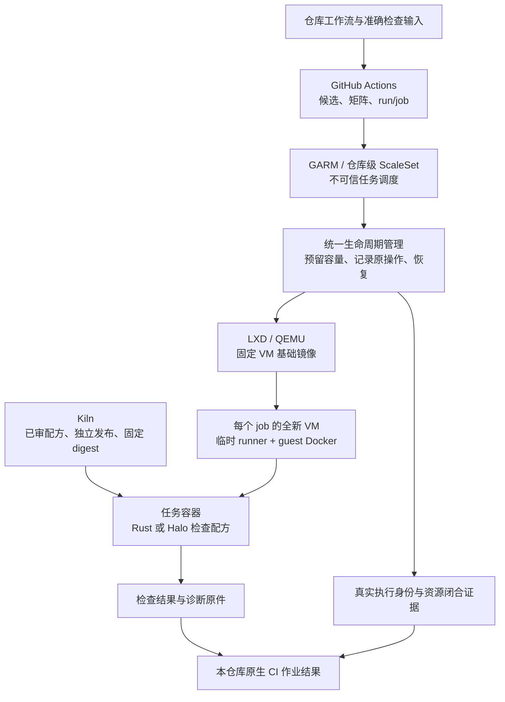

# CI 与运行边界

## 当前选择

agents、Nucleus 和 designs 各自维护仓库原生 CI、独立审查及分支保护。发布与部署使用独立入口。旧共享执行器 S、冻结配方 P、报告认证、集合准入和自动合并控制器已退役，不作为新 CI 的依赖或兼容目标。

旧线上 CI 门禁已移除。源码清理与新 CI 建设分别交付；本次删除不代表新工作流、必需检查或发布入口已经可用。

## 开发与交付

代码、测试、依赖和 workflow 可以在同一 PR 中修改。每次执行绑定准确提交，工具和依赖使用项目的版本及锁文件。独立审查同时判断业务代码、测试覆盖和 CI 配置变化，不能只凭检查绿色接纳已知缺陷。

经过受保护流程和独立审查接纳的 CI 配置成为后续运行基线。项目不要求依赖清单与旧版本逐字一致，也不要求每次升级先发布特权控制器或兼容配方。

普通错误由检查发现，检查机制的变化由独立审查判断，敏感凭据由权限隔离保护。执行来源可信只说明该次执行的事实，不证明业务覆盖充分。测试删除、断言弱化和空检查仍属于审查责任。

三库默认独立维护 workflow、选检、依赖准备、结果解释与发布入口。每库应能在自身 PR 中理解、修改、升级和回滚 CI，不要求同步升级其他仓库或先发布共同执行器。

共享 CI 不列为后续预定阶段。当前项目的语言、业务验收和运行环境不同，统一执行器增加了跨库发布、协议兼容和故障协调成本，现有证据不足以证明它降低了总维护成本。少量相似 YAML 和命令允许分别维护。

小型工具复用只在存在相同责任、真实消费者和可说明的维护收益时考虑。消费者独立选择版本，工具失败不要求其他仓库同步切换；若仍需共同发布或协调恢复，就重新判断复用是否值得。工具复用不拥有项目检查义务或最终审查判断。

## 发布与外部操作

普通检查不持发布凭据或管理权限。发布入口固定准确产物和目标，执行后读取实际结果。请求结果未知时沿原对象确认，不能用重新检查或重复发送代替恢复。

版本固定以单次执行和实际发布为单位，不将整包长期冻结作为普遍要求。操作日志、凭据和生产配置不进入源码。源码合入不自动部署、扩容或激活 runner。

## 删除与恢复边界

本次移除旧 CI 的共享执行器、固定配方、自动入口和专属依赖。旧源码仍可从 Git 历史读取，外部运行原件、原操作身份及未知结果继续保留。旧操作由其原恢复责任处理，不改写成新流程成功，也不因源码删除而重复发送。

runner 的 Go 代码及文档保持原 owner，已合入的资源诊断与恢复成果保留。下节继续约束 runner 和 Kiln 的资源隔离、容量与原操作恢复，不要求恢复旧 S/P 或准入平台。相关部署和后续实施仍按各自授权进行。

## runner 与 Kiln

Rust CI 与 Halo 共用 GARM/LXD 和生命周期管理，使用 Nucleus 仓库级不可信执行池。每个 job 使用全新 VM，初始总容量保持 1。可信控制器与发布任务留在独立信任域。第一版优先共用兼容的任务容器镜像，分别运行检查配方。任务名称不同不构成拆池依据。

本节记录共用架构和接入方案。文档交付不授权产品改动、镜像发布、配置切换或扩容。下文固定源码说明已有行为，准备材料只说明其实际覆盖。完整 VM 执行、私有拉取及连续排队仍待真实验收。

### 两层镜像与共用架构

VM 基础镜像提供系统、runner、guest Docker、网络和 bootstrap 基础。Kiln 容器镜像提供检查所需的 Rust、Bun、Node、PostgreSQL、浏览器和 nginx。前者由 runner 能力维护，后者由 Kiln 发布能力维护；Nucleus 拥有实际消费兼容性。容器镜像分开后仍可使用同一个 VM 池。

图中 Rust 与 Halo 是两种任务选择。任务容器是依赖封装，VM 承担不可信执行隔离。作业分别保留检查结果和资源闭合结果，不经过独立冻结控制器或自定义准入平台。计算资源可在权限与容量边界内共用，这不要求共用 CI 业务规则、发布版本或恢复流程。guest 的 Docker 权限不能等同于宿主 Docker 权限。GitHub 分别定义 ephemeral runner 的单 job 注销与机器后续清理。[runner 契约](https://docs.github.com/en/actions/reference/runners/self-hosted-runners)

| 所有者                      | 独占事实与责任                                         | 跨能力接口                                   |
| --------------------------- | ------------------------------------------------------ | -------------------------------------------- |
| 本仓库原生 CI               | 候选、检查选择、依赖环境和作业结果                     | 明确执行输入；分别读取检查结果和闭合结果     |
| GitHub Actions 与 GARM 适配 | 平台 run/job、真实分配、注册对象、请求与回执           | 返回平台事实，不自行判断 PR 合格             |
| runner 生命周期             | 容量、执行与资源对应、期限、取消、回收及未知操作恢复   | 申请执行、查询原执行、请求取消、读取闭合结果 |
| runner 部署维护             | 生效版本、安装前态、服务恢复及记录兼容性               | 固定 VM/bootstrap/provider 版本与恢复程序    |
| Kiln 发布                   | 配方、构建原件、发布操作和 registry digest             | 不可变镜像描述及兼容输入                     |
| Nucleus 消费者              | Rust/Halo 检查内容、工具版本、夹具、缓存用途及结果要求 | 固定业务检查配方与环境核验                   |

同一执行请求与相同输入返回原记录；相同身份而输入不同则拒绝。取消接口只记录原执行的取消意图。查询和恢复沿原 operation 及真实资源进行，结果分别表达工作结论、资源闭合、候选适用性。生命周期和部署各保留一个事实所有者；watchdog 复用生命周期入口，不新增平行状态机。GARM DB、GitHub、LXD 和 systemd 仍各自拥有对应外部事实。

runner 的 [Go 包选型](runner/architecture.md#已采用的-go-包)统一维护 SDK、系统接口和防火墙依赖。各包承担协议与技术访问，runner 仍拥有准入、容量和恢复判断。选型已接受，代码按独立实施片接入；文档合入不表示运行依赖或部署已切换。

### Rust 与 Halo 的实际消费链

以下源码事实固定到 Nucleus `fc73557bf5b1a63459bc3b67b0eb6de36d229965`，不代表后续分支或线上已切换。[Rust workflow](https://github.com/headironc/nucleus/blob/fc73557bf5b1a63459bc3b67b0eb6de36d229965/.github/workflows/rust.yml)、[Halo workflow](https://github.com/headironc/nucleus/blob/fc73557bf5b1a63459bc3b67b0eb6de36d229965/.github/workflows/halo.yml)

| 消费者          | 已有行为与依赖                                                                                                                  | 自托管接入责任                                       |
| --------------- | ------------------------------------------------------------------------------------------------------------------------------- | ---------------------------------------------------- |
| Rust 分类与发现 | `check-inputs.ts` 核事件候选及 Git 父关系；比较不可信时执行完整检查。`check-packages.ts` 读取 Cargo metadata 并补齐受影响消费者 | 沿用检查完整性；分类结果不能自证可信最低检查计划     |
| Rust tools      | Bun 类型检查与工具回归，部分回归实际调用 Rust/Clippy                                                                            | 核固定工具链，保留独立工具检查                       |
| Rust checks     | Rust 1.99.0、Clippy、独立 nightly-2026-09-06 rustfmt；setup 用 sudo apt 安装依赖，以 hosted 镜像和系统包生成缓存指纹            | 迁移时交付匹配的非 root 环境和指纹；不能仅改 runs-on |
| Rust packages   | 已与 Halo 使用同一固定 digest 的依赖镜像；逐包 build/test/rustdoc，Domain 四个 shard，Nucleus 分 http/rest 两组                 | 保留全部所选分片及分组，逐项绑定执行与闭合证据       |
| Halo website    | 同一依赖镜像，另运行网站生成、类型、测试、构建及浏览器验收；job 期限 30 分钟，浏览器原件保留 7 天                               | 保留 nginx、TLS、浏览器、后台进程与 artifact 语义    |

[输入分类器](https://github.com/headironc/nucleus/blob/fc73557bf5b1a63459bc3b67b0eb6de36d229965/tools/check-inputs.ts)与[包检查器](https://github.com/headironc/nucleus/blob/fc73557bf5b1a63459bc3b67b0eb6de36d229965/tools/check-packages.ts)拥有选检及测试分组规则。Rust package 的 `--test-threads 4` 只限制测试 harness，不限制 Cargo 编译并发。workflow 的 `max-parallel: 8` 只限制矩阵调度，不证明 VM 容量为 8，也不授权扩容。

[数据库夹具](https://github.com/headironc/nucleus/blob/fc73557bf5b1a63459bc3b67b0eb6de36d229965/fixture/src/lib.rs)消费固定 PostgreSQL 18.4 安装，每次创建隔离集群、临时证书和目录。共用安装镜像不表示共享数据目录或长期数据库服务。

Kiln `61bb03f128ee71c3003248469fe516f9ec685631` 的配方已使用 Ubuntu 26.04、Node 26 和 linux/amd64 输入。上述 Nucleus 基线的 verifier 仍要求 Node 24、旧 Playwright 基础与旧输入摘要。因此只换 digest 会被消费者拒绝。接入片核对工具版本、配方摘要和非 root 身份，同时核对 PostgreSQL 安装路径及 workspace 写权限。环境核验继续保留。[Kiln 配方](https://github.com/headironc/kiln/blob/61bb03f128ee71c3003248469fe516f9ec685631/Dockerfile)、[平台输入](https://github.com/headironc/kiln/blob/61bb03f128ee71c3003248469fe516f9ec685631/image.json)、[消费者核验](https://github.com/headironc/nucleus/blob/fc73557bf5b1a63459bc3b67b0eb6de36d229965/tools/halo-ci-image.ts)

### 同池、分镜像与独立池

| 方案                       | 采用条件与代价                                                                   | 当前选择                                     |
| -------------------------- | -------------------------------------------------------------------------------- | -------------------------------------------- |
| 同一 VM 基础、统一任务镜像 | 工具兼容、依赖高度重合；统一发布与核验，但携带双方依赖                           | 第一版优先，Rust packages 已有共同镜像消费者 |
| 同一 VM 基础、分任务镜像   | 依赖版本确需独立，或实测拉取、存储、升级成本值得拆分；维护更多 digest 与兼容组合 | 后续按实际数据评估，仍可同池                 |
| 独立执行池                 | 仓库访问范围、信任或凭据、操作系统/架构、专用硬件或网络隔离存在实质差异          | 出现实际隔离条件时采用，不按任务名称拆分     |

Rust 与 Halo 同池的前提是同一仓库授权范围、相同不可信权限边界、兼容的架构与资源规格，以及每个 job 的全新 VM。可信控制器、App 私钥消费者和发布任务与该池隔离。不同仓库可共用管理设施和基础配方，但仓库级不可信池的访问边界仍分别核验。

既有单 VM 准备规格为 8 vCPU、16 GiB 内存和 100 GiB 根盘。这是配方输入，不是 Rust 容量实测。当前缺少冷拉取、峰值内存、编译磁盘及排队耗时证据，不能宣称统一镜像或拆镜像更快。Rust 首次接入保留总容量 1；不足时拒绝或报告资源限制，不自动扩容、降低检查或缩短回收。

可信编排先固定执行请求、配方、候选、环境和权限；GitHub 分配后再从可信事实补齐 run/attempt/job、runner、GARM instance、VM、宿主及进程关系。JIT/ephemeral 只约束单 job，不证明创建时已经绑定指定 PR。

执行请求固定实际 commit/tree、目标基线、所验证前缀、检查配方及矩阵维度、Kiln digest、VM 基础镜像、runner/bootstrap/provider 版本和资源规格。执行分配后建立以下关联，不从 guest 上传的 JSON 自行认定：

`run / attempt / job / runner → GARM instance → VM UUID → host boot_id / QEMU PID+starttime / cgroup / writable volumes`

一次执行尝试对应一台全新 VM。基础设施失败后如需新尝试，保存与原尝试的关系及各自资源归属；不能换一台 VM 后沿用旧执行身份。PR 编号用于关联消费者，检查证据仍按实际语义输入复用。

保留一个任务的初始容量。容量槽从创建开始，覆盖 bootstrap、运行、注销和全部资源回收。成功、失败、取消、超时分别保留 job 结论；资源闭合结果与业务检查结果分开。存在 QEMU、cgroup、VM、卷或原操作残留时，不释放容量。

容量预留必须早于任何可能创建资源的动作。GitHub 或 GARM 显示 job 已结束，不授权 guard 提前释放槽位。队列可以继续等待，但后续任务不能在原执行未闭合时获得新 VM。当前单任务模型不自动扩展为多 VM 池。

### 生命周期与恢复

| 阶段             | 正常推进                           | 失败、取消或未知结果                                     |
| ---------------- | ---------------------------------- | -------------------------------------------------------- |
| 等待依赖和容量   | 固定输入及期限，取得容量预留       | 期限到后停止新分配；已发 dispatch 仍查原 run             |
| 创建和 bootstrap | 保存 provider 原操作与实际 VM 身份 | 查询原操作，阻止迟到创建或重复创建                       |
| 注册与分配       | 绑定真实 runner/job，核匹配关系    | 区分未分配、错配、注册失败，不伪装成测试失败             |
| 容器初始化       | 用短期 token 拉取准确私有 digest   | 记录环境准备失败，进入回收；不改用旧镜像                 |
| 运行             | 按固定配方、输入和期限执行         | 保存真实失败、取消或超时，不因本地等待结束认定远端已停止 |
| 终结与回收       | 核原 job 终态，注销并销毁原资源    | 回收超时仍占容量，保留原操作及恢复责任                   |
| 闭合             | 全部条件满足后解除 guard 占用      | 任何身份或终态不明都保持未闭合                           |

阶段期限写入原执行，不因服务重启、重复事件或等待者退出重置。容器初始化期限不额外延长已约定的 job 总期限。当前 Halo 的 30 分钟与受控 probe 的 5 分钟只按原消费者覆盖使用，不推广成所有任务的默认值。

闭合要求同时确认：原执行终态已核明；runner 已注销且不能继续接单；GARM 原实例已终结或经支持路径清理；VM、可写卷、快照及临时凭据已清理；原 QEMU 已退出，cgroup 无残留成员；相关创建、停止和删除操作均终结，没有可能迟到创建资源的原请求。

| 工作结果                        | 回收结果           | 对准入的含义                               |
| ------------------------------- | ------------------ | ------------------------------------------ |
| success                         | closed             | 可以接纳该执行覆盖的检查证据               |
| success                         | pending 或 unknown | 工作检查成功，但执行尚未闭合，不最终放行   |
| failure、cancelled 或 timed_out | closed             | 保存失败结论，由编排决定是否有新的合法尝试 |
| 任意结果                        | cleanup_failed     | 保留容量并进入恢复，不继续接单             |

候选已经失效时，迟到的成功和资源闭合只结束旧执行，不恢复旧准入。watchdog 与正常路径使用同一生命周期规则，不另造删除规则。

控制器重启先恢复未闭合记录和原资源身份，再处理新请求。宿主 boot 变化后，旧 PID 消失并不证明存储、runner 或外部操作已经闭合。没有捕获到的历史 QEMU 身份保持证据缺口。单写者锁只能防本地重复动作，不能宣称远端端到端 exactly-once。

迁后登记可能启动 manager，ScaleSet 创建可能出现 GitHub 成功而 GARM 保存失败，补偿删除也可能未知。恢复须核对应平台原对象；GARM 列表为空不授权重新创建。既有未知 login POST 不重放，不通过改 GARM 数据库补造登记或终态。

GARM 的消息接纳不是 PR 准入代理。已选执行边界为仓库级不可信池：池内所有 workload 都按不可信代码隔离，只有匹配可信请求的执行证据可进入 gate。非预期 job 可能占用计算资源；如实际分配到它，保留真实分配、拒绝证据接纳，并按同一生命周期完整回收，不提前释放容量。labels、max=1 和执行后的核对不提供执行前逐 job 拒绝保证；本方案不把这一更强能力作为已选要求。

该选择不放宽凭据边界。所有可能进入此池的工作流都必须满足不可信执行权限要求，而不只是最终被 gate 接纳的工作流。控制面私钥、管理会话、发布凭据及宿主 socket 不得因另一个 workflow 名称或未经核实的 Environment 条件进入 guest。启用前核仓库的实际工作流入口、token 权限及 Secret/Environment 授权；若无法阻止特权工作流或凭据进入该池，就保持池关闭。执行后拒绝报告不能撤回已经暴露的凭据。

阶段期限在执行前固定。取消只是对原执行的请求；超时不等于远端终止。创建、删除或安装响应丢失时查原对象及 operation，不重复发送。宿主重启延续原容量、期限和恢复责任；watchdog 调用同一生命周期规则。

Kiln 构建与发布分离，发布固定源码和产物 digest。Nucleus 用短期 job token 在 container 初始化阶段拉取 private 镜像，然后 checkout 准确候选。控制面凭据、管理 socket 和宿主目录不进入候选 VM。缓存与 artifact 按来源、输入、run/attempt、环境及信任域隔离，候选产物不得成为特权执行代码。

### 缓存与发布输入

第一版建议只让候选执行恢复受信依赖缓存，不生产供可信控制器或发布任务使用的缓存。缓存键包含仓库、信任域、架构、镜像 digest、工具链、锁文件及用途；禁止跨信任域的宽泛回落。不缓存数据库数据目录、凭据、浏览器 profile 或恢复记录。命中缓存仍执行所选检查，缓存缺失可重新准备依赖。

固定可信修订的生产者独立重建依赖缓存，不接收 PR 上传目录作为生产来源。沿用 package owner、Clippy 和 halo-http 的用途划分。共用缓存服务不共用宿主持久可写 target 目录。GitHub 缓存有分支及 PR 访问范围，工作流名称不同不构成信任边界。现有 setup 的正常恢复仍保留保存策略。接入片核实际 token、缓存 Action 与恢复范围，不能把建议的只读消费写成已实现保证。[现有缓存入口](https://github.com/headironc/nucleus/blob/fc73557bf5b1a63459bc3b67b0eb6de36d229965/.github/workflows/cache.yml)、[缓存访问规则](https://docs.github.com/en/actions/reference/workflows-and-actions/dependency-caching)

测试日志、截图和 trace 只作诊断及证据数据。Kiln 镜像归档则是发布输入，必须另核可信构建来源、配方、原 run/attempt、不可变 artifact ID 及归档摘要。artifact 名称、分支名或自述 provenance 不能替代这些来源。下载和解包限制大小、文件数、路径和链接，可信发布任务不 checkout 或执行候选配方代码。

### Kiln 首次发布与消费

首次完整链路为：固定已审配方与构建入口，在独立构建环境生成并验证镜像，接纳完整归档，再由发布任务核验、load、push。发布后回读包的 private 可见性、归属、registry digest，以及准确 Nucleus 仓库的 Actions Read 授权。配方 SHA、输入摘要、归档摘要与 registry digest 分别保存，不能相互替代，也不宣称当前 apt 来源已经逐字节可复现。

Nucleus 固定 `ghcr.io/headironc/kiln@sha256:…`，job 仅取得所需 `packages: read`，通过 `container.credentials` 使用短期 `GITHUB_TOKEN`。验收使用没有预热镜像、没有残留登录的全新 VM，覆盖有权拉取与无权拒绝。初始化拉取成功后再运行真实 Halo；checkout 后手工登录或添加长期 PAT 不属于替代路径。

当前发布候选只接纳 build attempt 1，artifact 保留一天。它们是既有消费者边界，不是新架构的永久参数。若选片要求支持 rerun 或更长留存，必须同时更新发布消费者、证据绑定和验收；原件过期后的重建形成新身份，不归入旧发布。

镜像升级验证工具链及完整 Halo 消费；回退消费已核旧 digest，仍保存原执行和生命周期历史。已接纳安装/WAL、首次服务入口及 guard 修复只按实际覆盖复用，不替代真实权限、VM 和私有拉取验收。

升级分别核验 Kiln 工具链及运行用户、runner 的 job/container 协议、VM 内核与存储、GARM/provider 的 API 和补偿行为，以及生命周期记录的读取兼容性。真实 Halo 还须覆盖 workspace 挂载、临时数据库、nginx、浏览器和 TLS 夹具；不能假定原 hosted job 的 sudo 安装步骤可直接用于新容器。

部署时先停新接单并排空旧执行，再激活完整配套版本；无法排空的原操作保留其固定恢复程序。回退代码不回滚 GARM DB/WAL，也不改写原执行的恢复程序记录。未知记录版本或兼容性无法证明时，停止相关恢复动作并保留容量。

### 接入缺口与最小实施顺序

GARM v0.2.1、native LXD provider v0.1.5 和固定私有 VM 基础镜像已有准备原件。安装/WAL、首次服务入口及 guard pin 修复也有准备原件。首次 repository/ScaleSet、真实 VM 单任务闭合与 Kiln 私有包消费仍待验收。正在开发的创建恢复入口及其替身测试不作为本节稳定实现依据。上线前由原 runner owner 提交准确成品和匹配证据。

现有单任务验收程序 `lifecycle.py` 的 `finish` 要求 ScaleSet disabled、GARM 实例列表为空。`absent_resources` 要求专用项目无实例、可写 VM 卷或快照，并核原 QEMU/cgroup 与 LXD 操作终态。该程序 SHA-256 为 `b49b153fd0e4904ece6793b14f9be9e81142b79c8479d9314cd9cd6edd32823f`，原件位于 dev 的 `runner-deployment/halo-20261026/vm-restore-guard-pin-20261026/`。这是固定准备原件的源码结论，不是当前宿主观测，也不是团队运行时依赖。

连续接单与该停接验收模型的衔接仍有缺口。runner 接入片说明停接条件、上一执行的闭合依据及下一次创建的放行条件，并实证两任务排队。仅换 runs-on 或调 max 不足以闭合这些责任。原登记、创建及未知结果恢复继续由 runner owner 单写。旧 sudo 拒绝和未知 login POST 保留，不由消费适配另找通道重试。

| 实施片             | 单一可观察结果                                                          | 必要内容与排除                                                                            |
| ------------------ | ----------------------------------------------------------------------- | ----------------------------------------------------------------------------------------- |
| 共同 runner 基础   | 一个受控 job 绑定真实执行身份，四种终态及失败恢复均能完整闭合           | 复用已接纳准备，完成登记/创建恢复、真实权限和连续排队；容量 1，不扩容                     |
| Rust 首个消费者    | 完整所选 package 矩阵在共同池执行，缺项、错配或未闭合无法形成可接纳结果 | 配套镜像兼容、初始化拉取、缓存边界和闭合消费；分类、tools、格式/Clippy 及汇总暂留现有环境 |
| Halo 消费者        | 同一基础设施完成网站、真实后端及浏览器验收并闭合                        | 保留 TLS、nginx、进程清理和原件语义；不复制生命周期                                       |
| 后续环境或容量优化 | 已接入消费者完成独立环境迁移或有依据的容量提升                          | 分镜像、迁移其余 Rust jobs、扩容分别选片；不从本次文档合入推导授权                        |

Rust 的 workflow 适配、可信检查计划及镜像消费兼容可与共同基础开发并行。真实 Rust 接入依赖共同生命周期和已核可消费镜像，不依赖 Halo 浏览器先接入；共用镜像的发布与验证可以支持两个消费者。各实施片分别选择和交付，不把该表当作一次性全路线授权。

| 验收场景            | 可接纳的观察结果                                                                                   |
| ------------------- | -------------------------------------------------------------------------------------------------- |
| 正常 Rust/Halo 执行 | 准确候选、配方、矩阵项、run/attempt/job、runner、VM 和镜像一致；工作与闭合结果分别核验             |
| 选检与覆盖          | 未知输入保守全检；所有所选 package、Domain shard、Nucleus group 均有结果；意外跳过、失败与错配拒绝 |
| 初始化或测试失败    | 区分 bootstrap、私有拉取、环境核验和业务测试失败；保留原结论，仍完整回收                           |
| 取消与超时          | 核原 job 的真实 cancelled/timed_out；取消请求回执和 run 总结不能代替 job 终态；回收未完仍占容量    |
| 创建/删除响应丢失   | 核原 intent、GitHub/GARM/LXD 对象和平台 operation；单侧残留或未知结果不重发、不释放槽              |
| 控制器/宿主重启     | 原期限、资源身份和容量占用延续；未捕获的历史身份保持缺口，不从旧 PID 消失推断闭合                  |
| 连续排队与残留      | 两个 job 的第二次创建晚于第一次完整闭合；QEMU、cgroup、卷、runner 或原操作残留均阻止放行           |
| 缓存与包权限        | 无预热、无残留登录的新 VM 通过初始化拉取；无权拉取与跨信任域缓存污染被拒绝                         |
| 镜像变更与回退      | 版本、输入摘要、运行用户、挂载和数据库夹具匹配；保留旧 operation 恢复，不用旧镜像掩盖新初始化失败  |

模型及替身测试只覆盖状态与拒绝规则。权限、私有包初始化、资源隔离、连续排队及四种 job 终态需要真实证据；既有未变输入的有效结果继续复用。检查绿色不单独证明资源闭合，完整闭合也不能替代业务检查或恢复已失效候选的准入。
