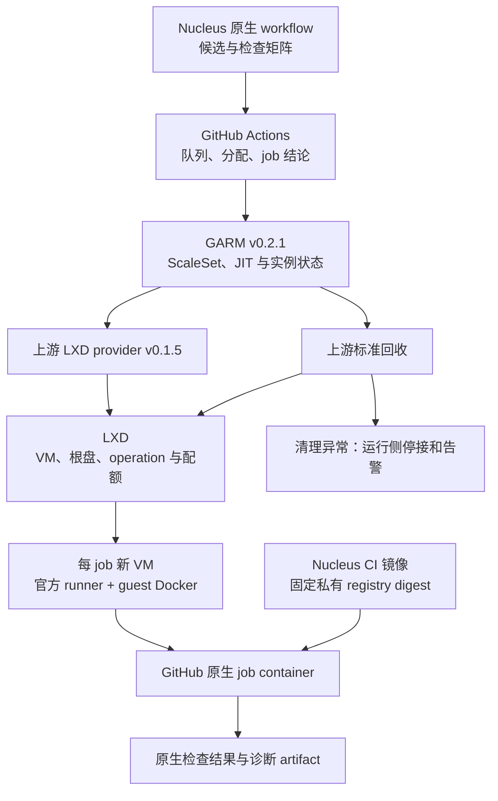

# CI 与运行边界

## 当前选择

agents、Nucleus 和 designs 各自维护仓库原生 CI、独立审查及分支保护。发布与部署使用独立入口。旧共享执行器 S、冻结配方 P、报告认证、集合准入和自动合并控制器已退役，不作为新 CI 的依赖或兼容目标。

旧线上 CI 门禁已移除。源码清理与新 CI 建设分别交付；旧入口退役不证明新入口已经可用。

## 开发与交付

代码、测试、依赖和 workflow 可以在同一 PR 中修改。每次执行绑定准确提交，工具和依赖使用项目的版本及锁文件。独立审查同时判断业务代码、测试覆盖和 CI 配置变化，不能只凭检查绿色接纳已知缺陷。

经过受保护流程和独立审查接纳的 CI 配置成为后续运行基线。项目不要求依赖清单与旧版本逐字一致，也不要求每次升级先发布特权控制器或兼容配方。

普通错误由检查发现，检查机制的变化由独立审查判断，敏感凭据由权限隔离保护。执行来源可信只说明该次执行的事实，不证明业务覆盖充分。测试删除、断言弱化和空检查仍属于审查责任。

三库默认独立维护 workflow、选检、依赖准备、结果解释与发布入口。每库应能在自身 PR 中理解、修改、升级和回滚 CI，不要求同步升级其他仓库或先发布共同执行器。

共享 CI 不列为后续预定阶段。当前项目的语言、业务验收和运行环境不同，统一执行器增加了跨库发布、协议兼容和故障协调成本，现有证据不足以证明它降低了总维护成本。少量相似 YAML 和命令允许分别维护。

小型工具复用只在存在相同责任、真实消费者和可说明的维护收益时考虑。消费者独立选择版本，工具失败不要求其他仓库同步切换；若仍需共同发布或协调恢复，就重新判断复用是否值得。工具复用不拥有项目检查义务或最终审查判断。

## 发布与外部操作

普通检查不持发布凭据或管理权限。发布入口固定准确产物和目标，执行后读取实际结果。发布结果未知时沿原对象确认，不能用重新检查或重复发布代替恢复。runner 正常回收采用的上游幂等合同由[运行架构](runner/architecture.md#正常删除与异常停接)维护。

版本固定以单次执行和实际发布为单位，不将整包长期冻结作为普遍要求。操作日志、凭据和生产配置不进入源码。源码合入不自动部署、扩容或激活 runner。

## 删除与恢复边界

旧 CI 的共享执行器、固定配方、自动入口和专属依赖已退役。旧源码仍可从 Git 历史读取，外部运行原件、原操作身份及未知结果继续保留。旧操作由其原恢复责任处理，不改写成新流程成功，也不因源码删除而重复发送。

已退役的自研 runner 源码由 Git 历史追溯，现场原件及历史恢复责任继续保留。正常目标由[精简架构](runner/architecture.md)维护，旧执行闭合及 unknown 由[历史恢复协议](runner/records-recovery.md)维护。下节只拥有跨库消费与不可信池边界，不恢复旧 S/P 或自有资源闭合准入平台。

## runner 与 Nucleus CI

Rust CI 与 Halo 目标共用 GARM v0.2.1、上游 LXD provider v0.1.5 和仓库级不可信 VM 池。每个 job 使用新 VM，初始容量为 1；可信控制面和发布任务位于独立信任域。Nucleus 维护兼容的 CI 容器镜像，任务名称不同不构成拆池依据。

本节拥有跨库消费、权限与验收边界。[运行架构](runner/architecture.md)拥有正常生命周期、组件版本、最小定制和迁移顺序。标准成功路径已验收，完整故障矩阵与生产 CI 切换仍未完成。下文分别说明源码合同和实际已验范围；源码合并不执行部署或扩容。

### 两层镜像与共用架构

VM 基础镜像提供系统、官方 runner、guest Docker 和必要 bootstrap 配置，不含旧实例身份。Nucleus CI 容器镜像提供 Rust、Bun、Node、PostgreSQL、浏览器及 nginx。两层镜像独立发布；Nucleus 拥有容器配方、构建、发布、工具兼容性及业务验收。独立 Kiln 仓库不再是当前必需发布者，其历史材料仍按原恢复责任保留。

VM 是不可信执行的隔离边界，任务容器只封装工具。guest Docker 权限不等于宿主 Docker 权限。GitHub ephemeral 的单 job 注销与基础设施清理分别由相应组件负责；正常回收不再等待自有跨平台封印。[GitHub runner 合同](https://docs.github.com/en/actions/reference/runners/self-hosted-runners)

| 所有者                       | 事实与责任                                   | 跨库消费                                  |
| ---------------------------- | -------------------------------------------- | ----------------------------------------- |
| GitHub Actions 与 Nucleus CI | 候选、矩阵、run/attempt/job、结论和取消/超时 | 按原生 checks、覆盖和仓库保护接纳         |
| GARM 与上游 provider         | runner 注册、ScaleSet、实例生命周期与恢复    | 使用支持的配置、API/CLI，不增设镜像状态机 |
| LXD                          | VM、根盘、operation 和 project 配额          | 正常回收接受其成功合同；异常保留平台事实  |
| runner 部署维护              | 固定版本、VM 镜像、网络、容量和告警          | 启用前验证安全配置及失败停接              |
| Nucleus 镜像维护             | 配方、构建来源、发布与 registry digest       | 提供固定镜像及兼容输入                    |
| Nucleus 消费者               | 实际 Rust/Halo 检查、夹具、缓存和结果要求    | 保留选检及业务覆盖，不自研容器调度器      |

初始使用一个 ScaleSet，min-idle=0、max-runners=1，并配置专用 LXD project/profile 的 VM、CPU、内存和根盘上限。标准配额不独立证明内核孤儿消失，磁盘限额也不证明物理空闲；存储池和镜像缓存的空闲告警属于部署责任。

### 当前源码与实际消费链

以下入口固定到已合并的 Nucleus `8017221d061ed934e99f9b08cf3265efdb1a132c`。它们说明该版本的消费者，不证明后续分支或生产路由已经切换。Nucleus 的[验证合同](https://github.com/headironc/nucleus/blob/8017221d061ed934e99f9b08cf3265efdb1a132c/docs/engineering/verification.md)拥有选检、检查范围和运行验收条件。

| 消费者                                                                                                                                                                                                                                             | 当前行为与边界                                                                                                                    |
| -------------------------------------------------------------------------------------------------------------------------------------------------------------------------------------------------------------------------------------------------- | --------------------------------------------------------------------------------------------------------------------------------- |
| [Runner probe](https://github.com/headironc/nucleus/blob/8017221d061ed934e99f9b08cf3265efdb1a132c/.github/workflows/runner-probe.yml)                                                                                                              | 受限手动入口核完整已审 revision；在 `nucleus-runners` 上以原生 container 拉取私有 digest，执行完整 platform 包、PG 清理和诊断上传 |
| [专用 JIT 模板与回归](https://github.com/headironc/nucleus/tree/8017221d061ed934e99f9b08cf3265efdb1a132c/.github/runner-probe)                                                                                                                     | 随首个真实消费者维护启动、身份保护和失败处理；源码回归不替代真实 VM 验收                                                          |
| [Packages](https://github.com/headironc/nucleus/blob/8017221d061ed934e99f9b08cf3265efdb1a132c/.github/workflows/packages.yml)                                                                                                                      | 实际 route 仍为 hosted `ubuntu-24.04`；包含 plan、PG producer、完整九行包矩阵及 aggregate，尚未迁入自托管池                       |
| [CI 镜像配方](https://github.com/headironc/nucleus/tree/8017221d061ed934e99f9b08cf3265efdb1a132c/.github/halo-ci)与 [Halo 消费合同](https://github.com/headironc/nucleus/blob/8017221d061ed934e99f9b08cf3265efdb1a132c/halo/README.md#ci-依赖镜像) | Nucleus 维护构建、发布、非 root 环境和工具兼容性；`halo-local` 保留完整网站及浏览器验收入口                                       |

[输入分类器](https://github.com/headironc/nucleus/blob/8017221d061ed934e99f9b08cf3265efdb1a132c/tools/check-inputs.ts)与[包矩阵入口](https://github.com/headironc/nucleus/blob/8017221d061ed934e99f9b08cf3265efdb1a132c/tools/native-packages.ts)拥有候选、选检和汇总规则。probe 的 `--test-threads 2` 限制测试 harness，`CARGO_BUILD_JOBS=2` 限制编译并发。Packages 的 `max-parallel: 8` 只限制 hosted 矩阵调度，不证明自托管 VM 容量为 8，也不授权扩容。

[数据库夹具](https://github.com/headironc/nucleus/blob/8017221d061ed934e99f9b08cf3265efdb1a132c/fixture/src/lib.rs)消费固定 PostgreSQL 18.4 安装，每次创建隔离集群、临时证书和目录。共用安装镜像不表示共享数据目录或长期数据库服务。

旧 Rust/Halo workflow 已归入 [retired fixtures](https://github.com/headironc/nucleus/tree/8017221d061ed934e99f9b08cf3265efdb1a132c/tools/fixtures/retired-workflows)，不再代表现行路由。镜像版本、输入摘要与兼容性由 [Nucleus 核验器](https://github.com/headironc/nucleus/blob/8017221d061ed934e99f9b08cf3265efdb1a132c/tools/halo-ci-image.ts)维护；旧 Kiln 与旧 verifier 的不匹配不再作为当前接入缺口。

### 同池、分镜像与独立池

| 方案                       | 采用条件与代价                                                                   | 当前选择                                           |
| -------------------------- | -------------------------------------------------------------------------------- | -------------------------------------------------- |
| 同一 VM 基础、统一任务镜像 | 工具兼容、依赖高度重合；统一发布与核验，但携带双方依赖                           | 当前 probe 消费 Nucleus 镜像；其他 CI 路由分别验收 |
| 同一 VM 基础、分任务镜像   | 依赖版本确需独立，或实测拉取、存储、升级成本值得拆分；维护更多 digest 与兼容组合 | 后续按实际数据评估，仍可同池                       |
| 独立执行池                 | 仓库访问范围、信任或凭据、操作系统/架构、专用硬件或网络隔离存在实质差异          | 出现实际隔离条件时采用，不按任务名称拆分           |

Rust 与 Halo 同池的前提是同一仓库授权范围、相同不可信权限边界、兼容的架构与资源规格，以及每个 job 的全新 VM。可信控制器、App 私钥消费者和发布任务与该池隔离。不同仓库可共用管理设施和基础配方，但仓库级不可信池的访问边界仍分别核验。

VM 的 CPU、内存和根盘规格由部署配置维护。已验冷拉取和一次 platform job 不构成全矩阵的峰值内存、编译磁盘及排队基准，不能据此宣称统一镜像或拆镜像更快。总容量仍为 1；不足时拒绝或报告资源限制，不自动扩容、降低检查或缩短回收。

### 生命周期与恢复

正常容量与实例状态由 GARM 管理。GitHub 负责 job 结论，provider/LXD 负责 VM 和根盘。job 完成、失败、取消或超时后，使用上游完成消息、超时及对账路径回收。controller 重启沿 GARM 持久化状态恢复，不另建正常 active/intent 状态机。

正常回收按[上游删除合同](runner/architecture.md#正常删除与异常停接)消费服务终态及幂等恢复，不把 HTTP 接纳或单侧记录消失当作清理成功。旧 Go/Python 的不重发与原回执合同保留在[历史恢复协议](runner/records-recovery.md#历史执行闭合与占用)，不改写旧 unknown。

清理失败、LXD 不可用或状态矛盾时，运行侧停止新分配并告警，保留原对象和日志。优先采用标准 disabled 或控制器运维路径，并验证禁止新建与继续回收的真实语义。不用忽略 IaaS 错误的 force-delete 伪装成功，也不承诺任意网络故障下的固定完成时限。

job 结论与基础设施健康是两项事实。CI 仍完整核实际候选、所选矩阵和业务结果；已完成检查不再等待自有 closed seal 才允许 PR 通过。清理异常通过运行侧停接/告警处理，不改写 job 结论或复活旧共享准入平台。原程序消费历史封印的规则只适用于旧操作。

可信工作流固定候选、检查输入及镜像。GitHub 的 run/attempt/job 与 GARM runner、LXD 实例通过平台事实关联，guest 自述不授予管理权限。初始标准路径的验证可保留准确对应关系，但不建立每 job 的 QEMU/PID 多平台证明服务。

仓库级不可信池内的所有 workload 都按不可信代码隔离。labels 和 max=1 不提供执行前逐 job 拒绝保证。所有可能进入该池的 workflow 必须核 token、Secret/Environment 及入口权限；不能只保护最终被接纳的检查。可信控制器、App 私钥、管理会话、发布凭据和宿主 socket 不进入 guest。执行后的报告拒绝不能撤回已暴露秘密。

阶段和 job 超时按消费者配置验证，取消回执不代替 job 终态。probe 用短期 job token 在原生 container 初始化阶段拉取 Nucleus 的 private digest，再 checkout 准确候选；不以长期 PAT 或事后登录替代。缓存与 artifact 沿下节按输入和信任域隔离。

### 缓存与发布输入

第一版建议只让候选执行恢复受信依赖缓存，不生产供可信控制器或发布任务使用的缓存。缓存键包含仓库、信任域、架构、镜像 digest、工具链、锁文件及用途；禁止跨信任域的宽泛回落。不缓存数据库数据目录、凭据、浏览器 profile 或恢复记录。命中缓存仍执行所选检查，缓存缺失可重新准备依赖。

当前 probe 不使用跨任务缓存。后续若接入缓存，由固定可信修订的生产者独立重建依赖，不接收 PR 上传目录作为生产来源。共用缓存服务不共用宿主持久可写 target 目录。GitHub 缓存有分支及 PR 访问范围，工作流名称不同不构成信任边界。接入时核实际 token、缓存 Action 与恢复范围，不能把建议的只读消费写成已实现保证。[缓存访问规则](https://docs.github.com/en/actions/reference/workflows-and-actions/dependency-caching)

测试日志、截图和 trace 只作诊断及证据数据。Nucleus 镜像归档则是发布输入，必须另核可信构建来源、配方、原 run/attempt、不可变 artifact ID 及归档摘要。artifact 名称、分支名或自述 provenance 不能替代这些来源。下载和解包限制大小、文件数、路径和链接，可信发布任务不 checkout 或执行候选配方代码。

### 镜像发布与已验范围

Nucleus 的[镜像发布与冷拉取合同](https://github.com/headironc/nucleus/blob/8017221d061ed934e99f9b08cf3265efdb1a132c/halo/README.md#首次私有包发布与冷拉取)拥有实际发布协议。构建、独立下载、发布及冷消费分别核验来源和结果。配方 SHA、输入摘要、归档摘要与 registry digest 分别保存，不能相互替代，也不宣称当前 apt 来源已经逐字节可复现。

当前 probe 固定消费 `ghcr.io/headironc/nucleus-ci@sha256:80ae416d4bc7287532c0974d25390c5bc9b27cd62defe4e64860b501414b4592`。job 仅取得所需 `packages: read`，通过 `container.credentials` 使用短期 `GITHUB_TOKEN`。独立发布 job 的写权限不进入不可信 VM。checkout 后手工登录或添加长期 PAT 不属于初始化拉取的替代路径。

已验范围分为两项：镜像的短期 job-token 冷消费，覆盖非 root、私有 PG、双 Chromium 和 133 个薄消费者测试；标准 VM 成功路径，覆盖原生初始化拉取、完整 platform 包、PG 与临时目录清理，以及 GARM 自动回收。后者核对了原 LXD 删除 operation 成功和对应实例、根盘缺席。operation 的 resources 为空，关联依赖唯一实例和时间窗，不能描述为独立逐资源证明。

已验 guest 挂载包括自身的 Actions 路径和 Docker socket；隔离边界是 VM。guest 未获得宿主管理 socket、App 私钥或管理 token。匿名 registry 401 仅在 dev host 观测，guest 无权拉取负例尚未执行，不能写成全部权限拒绝已验。

镜像升级核验工具链、运行用户和完整 Halo 消费；回退消费已核旧 digest，仍保存原执行和平台历史。runner、VM 和 GARM/provider 升级分别核协议、内核与存储、API 及恢复兼容性。真实 Halo 仍须覆盖 workspace、临时数据库、nginx、浏览器和 TLS；薄消费者或单个 platform probe 不替代完整网站验收。

部署时先停新接单并排空旧执行，再激活完整配套版本；无法排空的原操作保留其固定恢复程序。回退代码不回滚 GARM DB/WAL，也不改写原执行的恢复程序记录。未知记录版本或兼容性无法证明时，停止相关恢复动作并保持停接。

### 接入缺口与最小实施顺序

标准成功路径和对应源码已交付。故障、取消、超时、bootstrap 失败、专用控制器重启、容量、删除异常及连续排队的完整矩阵仍未验收。旧安装、登录、连接及资源请求的 unknown 由原 owner 保全，不因成功 probe 重试或关闭。

后续场景沿已审基线和单池容量逐片验证，准确顺序由[迁移边界](runner/architecture.md#迁移顺序与下一片)维护。失败开关的源码存在不证明现场验收通过；进行中的 run 也不计为已验。复用成功证据时，核模板字节和消费者输入未变。

生产切换另核实际 CI route、原生 checks、artifact、故障恢复及旧域隔离。Packages 仍走 hosted，一个手动 platform probe 不构成全库 CI 迁移。Rust 和 Halo 的消费适配可按各自独立结果推进，不要求先完成另一类任务。

| 验收面           | 启用前观察                                                                   |
| ---------------- | ---------------------------------------------------------------------------- |
| 正常 job         | 原生 job/runner/VM 对应，基础镜像与 Nucleus CI digest 正确，检查覆盖真实完整 |
| 选检与覆盖       | 未知输入保守全检；所选 package、shard 和 group 无意外缺项或错配              |
| 初始化与失败     | 区分 bootstrap、私有拉取、环境及业务失败，保留真实结论并进入上游回收         |
| 正常删除         | provider/LXD 原删除 operation 成功，实例和根盘按标准合同消失                 |
| 取消、超时、重启 | GitHub 终态与 GARM 的清理、对账和启动恢复均有实际用例                        |
| 异常与排队       | 删除失败不假报成功；告警及停接可用，容量配置与两任务排队行为符合预期         |
| 凭据与网络       | guest 无管理能力、宿主挂载及未授权网络路径；私有包有权成功、无权拒绝         |
| 缓存与镜像       | 信任域、工具、运行用户、挂载、数据库/TLS/browser 夹具和回退版本匹配          |

场景验收使用薄用例和原生日志，不建设常驻资源闭合门禁。部署与源码交付分开，故障未覆盖时保持生产池关闭。迁移不要求补造每条旧请求成功，但新池接单前必须证明旧写者、队列和凭据不会影响新域。
